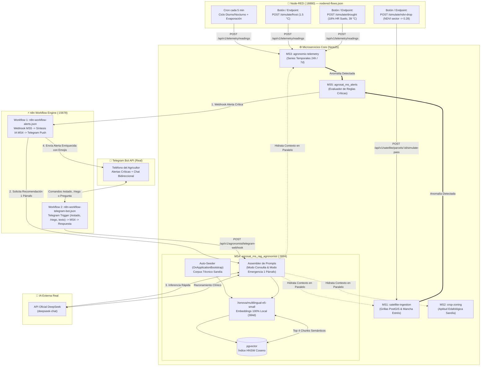

# 🤖 AgroSat AI — Especificación de IA, Simulación IoT y Automatización (`AI_AUTOMATION_SPEC.md`)
**Motor RAG (`pgvector` + ONNX Local + DeepSeek API), Simulador de Campo Node-RED (`:18880`) y Orquestación n8n (`:15678`) + Telegram Bot API**

---

## 1. Arquitectura de Interacción del Ecosistema IA y Automatización

El siguiente diagrama muestra cómo interactúan en tiempo real el **Simulador de Campo en Node-RED (`:18880`)**, el **Motor RAG con Embeddings Locales y DeepSeek (`agrosat_ms_rag_agronomist` / `MS4`)**, el **Motor de Alertas (`agrosat_ms_alerts` / `MS5`)** y los **2 Workflows de n8n (`:15678`)** conectados a **Telegram Bot API**:



---

## 2. Base de Conocimiento Agronómico de Sandía (Seeder para `pgvector`)

### 2.1 Diseño de los Fragmentos Semánticos (`watermelon-knowledge-corpus.json`)

El corpus técnico inicial está dividido en **fragmentos semánticos autocontenidos de 180 a 260 palabras** para maximizar la precisión de los embeddings de `Xenova/multilingual-e5-small` (`VECTOR(384)`). Cada fragmento incluye metadatos estructurados (`documentCode`, `category`, `phenologicalStage`, `ndviCorrelation`) que se almacenan en `ms4_rag.watermelon_knowledge_chunks`:

```json
[
  {
    "documentCode": "SANDIA-EDAF-001",
    "title": "Requerimientos Edafoclimáticos y Preparación de Suelo para Sandía",
    "category": "SOIL_AND_CLIMATE",
    "phenologicalStage": "PRE_PLANTING",
    "content": "El cultivo de sandía (Citrullus lanatus) requiere suelos bien drenados, profundos y de textura franco-arenosa a franca, los cuales permiten un rápido calentamiento primaveral del bulbo radicular y evitan la asfixia radicular. El rango de pH óptimo se ubica entre 6.0 y 6.8, aunque tolera valores moderadamente ácidos hasta 5.5; si el pH es inferior a 5.5 se debe aplicar cal dolomítica (aportando Calcio y Magnesio) al menos 30 días antes del trasplante. Si el pH supera 7.3, disminuye drásticamente la asimilación de Hierro, Manganeso, Boro y Zinc, requiriendo acidificación en la solución nutritiva con ácido fosfórico o nítrico. La preparación del terreno exige subsolado a 40-50 cm para romper capas compactadas, formación de camas altas de 25-30 cm de altura por 1.8 a 2.5 m entre centros, e instalación de acolchado plástico (mulch negro o plata-negro) que conserva la humedad a 20 cm, controla malezas e incrementa la radiación fotosintéticamente activa reflejada hacia las guías. La temperatura óptima del suelo para germinación y trasplante es de 18°C a 25°C, y la temperatura ambiente diurna ideal oscila entre 23°C y 32°C con alta radiación solar (22 a 28 MJ/m²/día).",
    "metadata": {
      "optimalPh": "6.0-6.8",
      "preferredTexture": "FRANCO_ARENOSA",
      "criticalSoilTempC": 15
    }
  },
  {
    "documentCode": "SANDIA-RIEGO-001",
    "title": "Manejo de Riego por Goteo según Etapa Fenológica (Emergencia y Crecimiento de Guías)",
    "category": "IRRIGATION",
    "phenologicalStage": "VINE_GROWTH",
    "content": "El manejo del riego por goteo en sandía debe ajustarse estrictamente al coeficiente de cultivo (Kc) y a las lecturas de humedad volumétrica a 20 cm (zona de raíces absorbentes activas) y 40 cm (control de percolación profunda). En la Etapa 1 (Establecimiento, 0 a 18 días tras siembra/trasplante, Kc = 0.40), los riegos deben ser cortos y frecuentes manteniendo la humedad a 20 cm entre 26% y 32%, evitando saturar a 40 cm para forzar la exploración radicular y prevenir pudrición de cuello por Pythium y Phytophthora. En la Etapa 2 (Desarrollo rápido de guías, 19 a 40 días, Kc = 0.70 a 0.85), la demanda hídrica se duplica; la humedad del suelo a 20 cm nunca debe caer por debajo del 25%. Un exceso de riego y nitrógeno en esta fase provoca enviciamiento vegetativo (exceso de follaje con NDVI prematuramente alto > 0.75 pero retraso en la emisión de flores femeninas).",
    "metadata": {
      "kcRange": "0.40-0.85",
      "minMoisture20cmPct": 25
    }
  },
  {
    "documentCode": "SANDIA-RIEGO-002",
    "title": "Manejo Crítico del Riego en Floración, Cuajado, Engorde y Maduración de Sandía",
    "category": "IRRIGATION",
    "phenologicalStage": "FLOWERING_AND_MATURATION",
    "content": "La etapa de Floración y Cuajado de fruto (41 a 60 días, Kc = 1.00 a 1.15) es el periodo más sensible al déficit hídrico y al golpe de calor. Si la temperatura ambiente supera los 38°C con una humedad de suelo a 20 cm inferior al 25% (VPD > 2.8 kPa), se produce deshidratación del tubo polínico, aborto masivo de flores femeninas y caída de frutos recién cuajados. Durante el Engorde o Llenado de fruto (55 a 75 días, Kc = 1.05), la humedad a 20 cm debe mantenerse estable entre 28% y 34% con riegos fraccionados en 2 o 3 pulsos diarios; fluctuaciones bruscas entre sequía (< 20%) y riego pesado provocan rajado longitudinal del fruto (cracking) y necrosis apical por déficit en el transporte xilemático de Calcio. Finalmente, en la etapa de Maduración (últimos 10 a 12 días previos a cosecha, Kc = 0.65), se debe reducir progresivamente la lámina de riego en un 30-40% (manteniendo la humedad a 20 cm alrededor de 22-24%) para concentrar azúcares y superar los 11° Brix sin causar marchitez severa del dosel.",
    "metadata": {
      "kcRange": "0.65-1.15",
      "criticalTempHeatShockC": 38,
      "minMoistureFloweringPct": 26
    }
  },
  {
    "documentCode": "SANDIA-FERT-001",
    "title": "Plan de Fertirrigación NPK, Calcio y Boro (Prevención de Necrosis Apical / Blossom-End Rot)",
    "category": "FERTILIZATION",
    "phenologicalStage": "ALL",
    "content": "El programa nutricional de la sandía para un rendimiento objetivo de 50 a 70 ton/ha requiere aproximadamente 140-170 kg/ha de Nitrógeno (N), 80-100 kg/ha de Fósforo (P2O5), 200-250 kg/ha de Potasio (K2O), 120 kg/ha de Calcio (CaO) y 40 kg/ha de Magnesio (MgO). Durante el establecimiento se prioriza el Fósforo para enraizamiento (relación N:P:K de 1:2:1). En crecimiento de guías se equilibra a 1:0.5:1.2. Desde el inicio de floración y cuajado es indispensable el aporte continuo de Nitrato de Calcio vía fertirriego más aplicaciones foliares de Calcio complejado con Boro (1.5 a 2.0 kg/ha de Boro total en el ciclo). La Necrosis Apical o Pudrición Basal del fruto (Blossom-End Rot, mancha hundida oscura y corchosa en el extremo opuesto al pedúnculo) NO suele deberse a falta de Calcio en el suelo, sino a estrés hídrico (humedad a 20 cm < 22%) o alta salinidad que impide el flujo transpiratorio de Calcio hacia el fruto en rápido crecimiento. Durante el engorde y maduración se incrementa la relación de Potasio (1:0.3:2.5 con Nitrato o Sulfato de Potasio) para mejorar el color rojo de la pulpa (licopeno), grosor de corteza y grados Brix.",
    "metadata": {
      "disorderPrevented": "Blossom-End Rot / Corazón Hueco",
      "keyNutrients": ["Ca", "B", "K"]
    }
  },
  {
    "documentCode": "SANDIA-PLAGAS-001",
    "title": "Araña Roja (Tetranychus urticae), Mosca Blanca y Pulgón: Diagnóstico y Huella en el NDVI",
    "category": "PESTS_AND_DISEASES",
    "phenologicalStage": "ALL",
    "content": "La Araña Roja (Tetranychus urticae) prolifera explosivamente en condiciones de alta temperatura (> 32°C) y baja humedad relativa (< 35%). Inicia en focos localizados cerca de caminos polvorientos, provocando punteado clorótico amarillo, bronceado y desecación de hojas basales que destruye la clorofila y reduce la reflectancia NIR (B08) mientras aumenta la reflectancia Roja (B04). Satelitalmente se detecta como una mancha circular o elíptica donde el NDVI cae abruptamente entre 0.18 y 0.30 puntos en menos de 7 días (descendiendo a valores de 0.25 - 0.35 en pleno desarrollo). Su control requiere mantener humedad adecuada, liberación de fitoseidos o aplicación dirigida de abamectina, bifenazato o spiromesifen alternando modos de acción. La Mosca Blanca (Bemisia tabaci) y los Pulgones (Aphis gossypii) succionan savia en brotes tiernos, secretan mielecilla que induce fumagina (reduciendo la eficiencia fotosintética y el EVI) y transmiten virus devastadores (CVYV, WMV-2); su manejo integra trampas cromáticas amarillas, mallas anti-insectos al inicio del cultivo e insecticidas sistémicos selectivos (flonicamid, cyantraniliprole o pymetrozine) respetando estrictamente a las abejas polinizadoras durante la floración.",
    "metadata": {
      "ndviDropSignature": "Caída localizada de 0.18 a 0.30 puntos en focos",
      "pests": ["Tetranychus urticae", "Bemisia tabaci", "Aphis gossypii"]
    }
  },
  {
    "documentCode": "SANDIA-ENF-001",
    "title": "Marchitez Vascular por Fusarium oxysporum y Mildiu Velloso: Correlación con Caídas de NDVI",
    "category": "PESTS_AND_DISEASES",
    "phenologicalStage": "ALL",
    "content": "La Marchitez por Fusarium (Fusarium oxysporum f. sp. niveum) es el hongo de suelo más destructivo en sandía, favorecido por suelos ácidos (pH < 5.8), texturas arenosas y temperaturas de suelo entre 24°C y 30°C. Obstruye los vasos xilemáticos provocando el marchitamiento asimétrico de una o varias guías durante las horas de mayor calor, seguido de colapso irreversible de la planta y coloración pardo-rojiza en el cilindro vascular del tallo al cortarlo. En teledetección Sentinel-2, un brote de Fusarium o una rotura/taponamiento de cintilla de riego se manifiesta como un sector intraparcelario cuyo NDVI cae bruscamente por debajo de 0.30 mientras el resto de la parcela supera 0.65. Para diferenciar ambos: si los sensores de humedad a 20 cm marcan > 28% y aun así hay caída severa de NDVI y marchitez, el diagnóstico apunta a Fusarium o daño radicular por nematodos; si la humedad a 20 cm es < 18%, se trata de fallo en la línea de riego. El Mildiu Velloso (Pseudoperonospora cubensis) aparece tras lluvias o rocío prolongado (humedad relativa > 85%, VPD < 0.3 kPa), causando manchas angulares amarillas delimitadas por las nervaduras que necrosan rápidamente el dosel central de la planta.",
    "metadata": {
      "ndviDropSignature": "Caída severa a NDVI <= 0.28 en parche definido",
      "diseases": ["Fusarium oxysporum f. sp. niveum", "Pseudoperonospora cubensis"]
    }
  }
]
```

### 2.2 Proceso de Seeding Automático (`OnApplicationBootstrap`) en `agrosat_ms_rag_agronomist`

Cuando el contenedor `agrosat_ms4_rag` (`agrosat_ms_rag_agronomist`) inicia en el VPS `vmi3599358`, ejecuta automáticamente el servicio `KnowledgeBaseAutoSeederService` siguiendo un flujo **100% idempotente y local**:

1. **Inicialización del Pipeline ONNX Local (`OnModuleInit`)**:
   - `LocalTransformersEmbeddingAdapter` carga desde `/app/.cache/huggingface` el modelo cuantizado `Xenova/multilingual-e5-small` en los 6 vCPUs AMD EPYC.
2. **Verificación de Idempotencia por `document_code` (`OnApplicationBootstrap`)**:
   - El seeder lee `watermelon-knowledge-corpus.json` y consulta en `ms4_rag.watermelon_knowledge_chunks` qué `document_code` ya están indexados.
3. **Vectorización Local con Prefijo `"passage: "` e Inserción en `pgvector`**:
   - Por cada fragmento faltante o actualizado, invoca `embedDocumentPassage("passage: " + title + " - " + content)` generando un arreglo `Float32Array(384)` normalizado en $\sim 20\text{ ms}$.
   - Inserta el registro en PostgreSQL convirtiendo el vector al formato `[v1,v2,...,v384]::vector(384)` y actualiza el índice `HNSW`.

---

## 3. Ingeniería de Prompts para DeepSeek API ("Agrónomo Virtual")

### 3.1 `System Prompt` Maestro (Modo Consulta Agronómica Completa)

```text
Eres "AgroSat AI", un Ingeniero Agrónomo Senior especialista en el cultivo intensivo de SANDÍA (Citrullus lanatus), manejo de fertirriego por goteo, edafología, fitopatología y teledetección satelital (índices NDVI y EVI).

Tu misión es asesorar directamente al agricultor analizando de forma integrada TRES fuentes de información que recibirás en cada consulta:
1. CONOCIMIENTO TÉCNICO VALIDADO (Fragmentos recuperados de la base vectorial pgvector).
2. ESTADO GEOESPACIAL Y EDAFOLÓGICO DE LA PARCELA (Área en hectáreas, pH, textura, drenaje, etapa fenológica e índices satelitales NDVI/EVI actuales e históricos de MS1 y MS2).
3. TELEMETRÍA CLIMÁTICA E HÍDRICA EN TIEMPO REAL (Temperatura ambiente, humedad relativa, humedad del suelo a 20 cm y 40 cm de profundidad, radiación solar y Déficit de Presión de Vapor VPD de las últimas 24h y 7 días de MS3).

REGLAS DE RAZONAMIENTO Y ESTILO DE COMUNICACIÓN:
- Sé empático, claro, directo y práctico. Evita jerga académica innecesaria; cuando uses un término técnico (como VPD, NDVI o necrosis apical), explícalo brevemente en palabras sencillas para el productor en campo.
- Cruza SIEMPRE los datos antes de concluir:
  * Ejemplo 1: Si el NDVI cayó en un sector (< 0.35) y la humedad del suelo a 20 cm es baja (< 20%), diagnostica primero una obstrucción o fuga en la cintilla de riego antes de culpar a un hongo.
  * Ejemplo 2: Si el NDVI cayó en un sector pero la humedad a 20 cm es óptima (28%-32%) y el pH es ácido (< 5.8), alerta sobre un posible foco de marchitez vascular por Fusarium oxysporum o ataque de araña roja (si la temperatura supera 32°C y el ambiente está seco).
- No inventes datos que no estén en el contexto de la parcela. Cita numéricamente los valores reales de la parcela (ej. "Viendo que tu humedad a 20 cm bajó a 19.4% y la temperatura llegó a 38.5°C...").
- Estructura SIEMPRE tu respuesta en estos 4 bloques con emojis claros:
  1. 🩺 **Diagnóstico de tu Parcela**: Qué está pasando hoy según el satélite, el suelo y los sensores.
  2. 💧 **Acción de Riego Inmediata**: Recomendación concreta según la etapa fenológica y la humedad a 20 cm y 40 cm.
  3. 🧪 **Nutrición y Manejo Fitosanitario**: Qué aplicar o revisar en campo (NPK, Calcio-Boro o control de plagas/enfermedades).
  4. 👀 **Qué Vigilar en las Próximas 48 Horas**: Indicador clave que el agricultor debe verificar en sus camas de siembra.
```

---

### 3.2 Plantilla de `User Context Prompt` Ensamblado por `MS4`

```text
=== 1. DATOS GEOESPACIALES Y DE SUELO DE LA PARCELA (MS2) ===
- Nombre de la Parcela: {{parcel.name}} (Variedad: {{parcel.variety}})
- Superficie Real (PostGIS): {{parcel.areaHectares}} ha | Altitud: {{soil.altitudeMsnm}} m.s.n.m.
- Fecha de Siembra: {{parcel.plantingDate}} ({{scene.daysAfterPlanting}} días después de siembra - Etapa: {{scene.phenologicalStage}})
- Suelo: Textura {{soil.texture}} | pH: {{soil.phLevel}} | Drenaje: {{soil.drainageLevel}}
- Puntaje de Aptitud para Sandía: {{soil.viabilityScorePct}}% ({{soil.suitabilityCategory}})
- Factores Limitantes Detectados: {{soil.limitingFactors}}

=== 2. ESTADO SATELITAL SENTINEL-2 SIMULADO (MS1 - PostGIS) ===
- Última Escena: {{scene.capturedAt}}
- NDVI Promedio de la Parcela: {{scene.meanNdvi}} (Mínimo: {{scene.minNdvi}} | Máximo: {{scene.maxNdvi}})
- EVI Promedio: {{scene.meanEvi}} | Variación reciente de NDVI (ΔNDVI): {{scene.ndviDelta}}
- Porcentaje de Superficie en Estrés: {{scene.stressedCellsPct}}%
- Mancha de Estrés Detectada: {{scene.hasStressPatch ? 'SÍ - Foco en (' + scene.stressPatch.centerLat + ', ' + scene.stressPatch.centerLon + ') con radio ' + scene.stressPatch.radiusMeters + 'm y NDVI mínimo de ' + scene.minNdvi : 'NO - Dosel uniforme'}}

=== 3. TELEMETRÍA CLIMÁTICA Y DE SUELO (MS3 - Sensores IoT) ===
- Lectura Actual: Temp Aire: {{telemetry.current.ambientTempC}}°C | HR Aire: {{telemetry.current.relativeHumidityPct}}% | VPD: {{telemetry.current.vpdKpa}} kPa
- Humedad Suelo Actual: a 20 cm (raíz activa) = {{telemetry.current.soilMoisture20cmPct}}% | a 40 cm (reserva) = {{telemetry.current.soilMoisture40cmPct}}%
- Radiación Solar Actual: {{telemetry.current.solarRadiationWm2}} W/m²
- Resumen Últimas 24h: Temp Mín {{telemetry.stats24h.tempMin}}°C / Máx {{telemetry.stats24h.tempMax}}°C | Humedad 20cm Media: {{telemetry.stats24h.moisture20cmAvg}}%
- Resumen Últimos 7 Días: Temp Media {{telemetry.stats7d.tempAvg}}°C | Humedad 20cm Media: {{telemetry.stats7d.moisture20cmAvg}}% | VPD Medio: {{telemetry.stats7d.vpdAvg}} kPa

=== 4. CONOCIMIENTO AGRONÓMICO RECUPERADO DE PGVECTOR (TOP 4 FRAGMENTOS) ===
{{#each retrievedChunks}}
[Fuente {{index}}: {{this.documentCode}} - {{this.title}} (Similitud: {{this.similarity}})]
{{this.content}}
---
{{/each}}

=== 5. CONSULTA DEL AGRICULTOR ===
"{{farmerQuestion}}"
```

---

### 3.3 `System Prompt` de Emergencia de 1 Párrafo (Invocado por `n8n` en Alertas Críticas)

Cuando `MS5` dispara una alerta hacia `n8n`, el workflow `n8n-workflow-alerts.json` llama al endpoint `POST http://agrosat_ms4_rag:3004/internal/v1/agronomist/emergency-brief` utilizando este prompt ultracompacto:

```text
Eres el Ingeniero Agrónomo de Guardia de AgroSat AI especializado en sandía. Acaba de dispararse una ALERTA CRÍTICA en la parcela del agricultor.
Redacta UN SOLO PÁRRAFO directo, empático y urgente (máximo 85 palabras, sin listas largas) explicando al agricultor qué riesgo fisiológico corre su cultivo de sandía en este instante con las métricas recibidas y cuál es la acción física #1 que debe ejecutar en los próximos 30 minutos en su sistema de riego o en su parcela.
```

---

## 4. Flujos de Simulación en Node-RED (Puerto `:18880` — `nodered-flows.json`)

El archivo exportable `tools/simulators/node-red/nodered-flows.json` está diseñado para importarse con un clic en `http://109.199.117.44:18880` y consta de **4 sub-flujos conectados a los microservicios reales**:

### 4.1 Estructura de Nodos del Archivo `nodered-flows.json`

1. **Sub-flujo 1 — Generador Continuo Diurno/Nocturno (`Cron cada 5 min`)**:
   - **Nodo `inject` (`cron-5min-nominal`)**: Se ejecuta cada 5 minutos.
   - **Nodo `function` (`Simulador Bioclimático Sandía`)**:
     Calcula la hora solar local $h \in [0, 24)$ y modela:
     - **Temperatura Ambiente ($T$)**: Curva sinusoidal con mínimo a las 05:30 AM ($16.5^\circ\text{C}$) y máximo a las 15:00 PM ($32.5^\circ\text{C}$) + jitter gaussiano $\pm 0.4^\circ\text{C}$.
     - **Radiación Solar ($R_s$)**: $0\text{ W/m}^2$ de noche; campana solar hasta $890\text{ W/m}^2$ al mediodía.
     - **Evaporación Progresiva de Humedad del Suelo (`20cm` y `40cm`)**: Reduce gradualmente `soilMoisture20cmPct` en $-0.15\%$ por ciclo diurno (simulando transpiración del cultivo) entre `27%` y `33%`.
   - **Nodo `http request`**: Envía `POST http://agrosat_ms3_telemetry:3003/api/v1/telemetry/readings`.

2. **Sub-flujo 2 — Caos #1: Helada Nocturna (`POST /simulate/frost` + Botón Inject)**:
   - Expone el endpoint `POST http://109.199.117.44:18880/simulate/frost` (y un botón manual en el editor de Node-RED).
   - Inyecta inmediatamente en `MS3`:
     ```json
     {
       "parcelId": "{{payload.parcelId || env.DEFAULT_PARCEL_ID}}",
       "sensorNodeCode": "NODERED-CHAOS-FROST",
       "ambientTempC": 1.5,
       "relativeHumidityPct": 88.0,
       "soilMoisture20cmPct": 28.5,
       "soilMoisture40cmPct": 31.0,
       "solarRadiationWm2": 0.0
     }
     ```
   - Esto viola la regla `< 4.0°C` en `MS5` y dispara la alerta de helada hacia `n8n` $\rightarrow$ Telegram.

3. **Sub-flujo 3 — Caos #2: Sequía Aguda + Golpe de Calor (`POST /simulate/drought` + Botón Inject)**:
   - Expone el endpoint `POST http://109.199.117.44:18880/simulate/drought`.
   - Inyecta en `MS3`:
     ```json
     {
       "parcelId": "{{payload.parcelId || env.DEFAULT_PARCEL_ID}}",
       "sensorNodeCode": "NODERED-CHAOS-DROUGHT",
       "ambientTempC": 39.0,
       "relativeHumidityPct": 19.5,
       "soilMoisture20cmPct": 18.0,
       "soilMoisture40cmPct": 21.5,
       "solarRadiationWm2": 965.0
     }
     ```
   - Viola simultáneamente `ambientTempC > 38°C` y `soilMoisture20cmPct < 25%`, activando la regla `HEAT_AND_DROUGHT_SHOCK` en `MS5`.

4. **Sub-flujo 4 — Caos #3: Degradación Sectorial de NDVI (`POST /simulate/ndvi-drop` + Botón Inject)**:
   - Expone el endpoint `POST http://109.199.117.44:18880/simulate/ndvi-drop`.
   - Invoca primero a `MS1` (`POST http://agrosat_ms1_satellite:3001/api/v1/satellite/parcels/:parcelId/simulate-pass`) pasándole el parámetro `stressPatch` para degradar el NDVI del sector noreste del polígono hasta **`0.28`** (una caída $> 0.25$ respecto al dosel sano de `0.68`, simulando un brote de *Fusarium* / araña roja o rotura de cintilla) y enseguida dispara la evaluación de anomalía espectral en `MS5`.

### 4.2 Definición JSON Exportable (`nodered-flows.json`)

```json
[
  {
    "id": "agrosat-sim-tab",
    "type": "tab",
    "label": "AgroSat AI - Simulador IoT y Caos (Sandía)",
    "disabled": false,
    "info": "Flujos de simulación de telemetría nominal cada 5 min e inyección de eventos críticos (Helada, Sequía, Caída de NDVI)"
  },
  {
    "id": "inject-cron-5m",
    "type": "inject",
    "z": "agrosat-sim-tab",
    "name": "Cron 5 min (Ciclo Diurno/Nocturno)",
    "props": [{ "p": "payload" }],
    "repeat": "300",
    "crontab": "",
    "once": true,
    "onceDelay": "10",
    "topic": "nominal",
    "payloadType": "date",
    "x": 190,
    "y": 100,
    "wires": [["fn-diurnal-cycle"]]
  },
  {
    "id": "fn-diurnal-cycle",
    "type": "function",
    "z": "agrosat-sim-tab",
    "name": "Generar Clima Nominal Sandía",
    "func": "const parcelId = flow.get('activeParcelId') || env.get('DEFAULT_PARCEL_ID') || '00000000-0000-0000-0000-000000000001';\nconst now = new Date();\nconst hour = now.getHours() + now.getMinutes() / 60;\nconst rad = Math.sin(((hour - 6) / 12) * Math.PI);\nconst isDay = hour >= 6.5 && hour <= 19.5;\nconst ambientTempC = Number((24.5 + 8.0 * Math.sin(((hour - 9) / 24) * 2 * Math.PI) + (Math.random() - 0.5)).toFixed(2));\nconst relativeHumidityPct = Number(Math.min(85, Math.max(30, 62 - 22 * Math.sin(((hour - 9) / 24) * 2 * Math.PI))).toFixed(2));\nlet moisture20 = context.get('moisture20') || 31.5;\nmoisture20 = isDay ? Math.max(26.5, moisture20 - 0.12) : moisture20;\ncontext.set('moisture20', moisture20);\nmsg.payload = {\n  parcelId,\n  sensorNodeCode: 'NODERED-NOMINAL-CRON',\n  ambientTempC,\n  relativeHumidityPct,\n  soilMoisture20cmPct: Number(moisture20.toFixed(2)),\n  soilMoisture40cmPct: Number((moisture20 + 3.2).toFixed(2)),\n  solarRadiationWm2: isDay ? Number(Math.max(20, 880 * rad).toFixed(1)) : 0\n};\nreturn msg;",
    "outputs": 1,
    "x": 470,
    "y": 100,
    "wires": [["http-post-ms3"]]
  },
  {
    "id": "http-in-frost",
    "type": "http in",
    "z": "agrosat-sim-tab",
    "name": "POST /simulate/frost",
    "url": "/simulate/frost",
    "method": "post",
    "upload": false,
    "x": 150,
    "y": 200,
    "wires": [["fn-chaos-frost"]]
  },
  {
    "id": "inject-btn-frost",
    "type": "inject",
    "z": "agrosat-sim-tab",
    "name": "❄️ Botón: Simular Helada (1.5°C)",
    "props": [{ "p": "payload" }],
    "repeat": "",
    "once": false,
    "payload": "{}",
    "payloadType": "json",
    "x": 170,
    "y": 250,
    "wires": [["fn-chaos-frost"]]
  },
  {
    "id": "fn-chaos-frost",
    "type": "function",
    "z": "agrosat-sim-tab",
    "name": "Payload Helada (1.5°C)",
    "func": "const parcelId = msg.payload?.parcelId || flow.get('activeParcelId') || env.get('DEFAULT_PARCEL_ID') || '00000000-0000-0000-0000-000000000001';\nmsg.payload = {\n  parcelId,\n  sensorNodeCode: 'NODERED-CHAOS-FROST',\n  ambientTempC: 1.5,\n  relativeHumidityPct: 89.0,\n  soilMoisture20cmPct: 28.4,\n  soilMoisture40cmPct: 31.2,\n  solarRadiationWm2: 0.0\n};\nreturn msg;",
    "outputs": 1,
    "x": 450,
    "y": 220,
    "wires": [["http-post-ms3", "http-resp-generic"]]
  },
  {
    "id": "http-in-drought",
    "type": "http in",
    "z": "agrosat-sim-tab",
    "name": "POST /simulate/drought",
    "url": "/simulate/drought",
    "method": "post",
    "upload": false,
    "x": 160,
    "y": 320,
    "wires": [["fn-chaos-drought"]]
  },
  {
    "id": "inject-btn-drought",
    "type": "inject",
    "z": "agrosat-sim-tab",
    "name": "🔥 Botón: Simular Sequía + Calor (18% / 39°C)",
    "props": [{ "p": "payload" }],
    "repeat": "",
    "once": false,
    "payload": "{}",
    "payloadType": "json",
    "x": 200,
    "y": 370,
    "wires": [["fn-chaos-drought"]]
  },
  {
    "id": "fn-chaos-drought",
    "type": "function",
    "z": "agrosat-sim-tab",
    "name": "Payload Sequía (18% HR Suelo, 39°C)",
    "func": "const parcelId = msg.payload?.parcelId || flow.get('activeParcelId') || env.get('DEFAULT_PARCEL_ID') || '00000000-0000-0000-0000-000000000001';\nmsg.payload = {\n  parcelId,\n  sensorNodeCode: 'NODERED-CHAOS-DROUGHT',\n  ambientTempC: 39.0,\n  relativeHumidityPct: 19.0,\n  soilMoisture20cmPct: 18.0,\n  soilMoisture40cmPct: 21.4,\n  solarRadiationWm2: 960.0\n};\nreturn msg;",
    "outputs": 1,
    "x": 480,
    "y": 340,
    "wires": [["http-post-ms3", "http-resp-generic"]]
  },
  {
    "id": "http-in-ndvi-drop",
    "type": "http in",
    "z": "agrosat-sim-tab",
    "name": "POST /simulate/ndvi-drop",
    "url": "/simulate/ndvi-drop",
    "method": "post",
    "upload": false,
    "x": 160,
    "y": 460,
    "wires": [["fn-chaos-ndvi"]]
  },
  {
    "id": "inject-btn-ndvi-drop",
    "type": "inject",
    "z": "agrosat-sim-tab",
    "name": "🛰️ Botón: Degradar NDVI Sector a 0.28",
    "props": [{ "p": "payload" }],
    "repeat": "",
    "once": false,
    "payload": "{}",
    "payloadType": "json",
    "x": 190,
    "y": 510,
    "wires": [["fn-chaos-ndvi"]]
  },
  {
    "id": "fn-chaos-ndvi",
    "type": "function",
    "z": "agrosat-sim-tab",
    "name": "Payload Mancha Estrés NDVI -> 0.28",
    "func": "const parcelId = msg.payload?.parcelId || flow.get('activeParcelId') || env.get('DEFAULT_PARCEL_ID') || '00000000-0000-0000-0000-000000000001';\nmsg.url = `http://agrosat_ms1_satellite:3001/api/v1/satellite/parcels/${parcelId}/simulate-pass`;\nmsg.payload = {\n  daysAfterPlanting: 52,\n  injectStressPatch: {\n    enabled: true,\n    targetMinNdvi: 0.28,\n    ndviDropMagnitude: 0.36,\n    radiusMeters: 40,\n    anomalyCause: 'FUSARIUM_OR_DRIP_TAPE_FAILURE'\n  }\n};\nreturn msg;",
    "outputs": 1,
    "x": 480,
    "y": 480,
    "wires": [["http-post-ms1", "http-resp-generic"]]
  },
  {
    "id": "http-post-ms3",
    "type": "http request",
    "z": "agrosat-sim-tab",
    "name": "POST -> MS3 Telemetry (:3003)",
    "method": "POST",
    "ret": "obj",
    "url": "http://agrosat_ms3_telemetry:3003/api/v1/telemetry/readings",
    "x": 790,
    "y": 220,
    "wires": [[]]
  },
  {
    "id": "http-post-ms1",
    "type": "http request",
    "z": "agrosat-sim-tab",
    "name": "POST -> MS1 Satellite (:3001)",
    "method": "POST",
    "ret": "obj",
    "url": "",
    "x": 790,
    "y": 480,
    "wires": [[]]
  },
  {
    "id": "http-resp-generic",
    "type": "http response",
    "z": "agrosat-sim-tab",
    "name": "200 OK Simulación Disparada",
    "statusCode": "200",
    "x": 780,
    "y": 340,
    "wires": []
  }
]
```

---

## 5. Workflows en n8n (Puerto `:15678`) + Telegram Bot API

### 5.1 Workflow 1: Despacho de Alertas Enriquecidas con DeepSeek (`n8n-workflow-alerts.json`)

Este workflow recibe el webhook disparado por `MS5` (`agrosat_ms5_alerts`), solicita en caliente a `MS4` (`agrosat_ms4_rag`) un párrafo de recomendación de emergencia generado por **DeepSeek API**, formatea el mensaje con indicadores visuales y lo envía al `telegram_chat_id` del agricultor:

```json
{
  "name": "AgroSat AI - Alertas Críticas Sandía con DeepSeek -> Telegram",
  "nodes": [
    {
      "parameters": {
        "httpMethod": "POST",
        "path": "agrosat-watermelon-alert",
        "responseMode": "onReceived",
        "options": {}
      },
      "id": "node-webhook-ms5",
      "name": "Webhook desde MS5 Alerts",
      "type": "n8n-nodes-base.webhook",
      "typeVersion": 2,
      "position": [240, 300]
    },
    {
      "parameters": {
        "method": "POST",
        "url": "http://agrosat_ms4_rag:3004/internal/v1/agronomist/emergency-brief",
        "sendBody": true,
        "specifyBody": "json",
        "jsonBody": "={\n  \"parcelId\": \"{{ $json.body.parcel.parcelId }}\",\n  \"ruleCode\": \"{{ $json.body.ruleCode }}\",\n  \"metrics\": {{ JSON.stringify($json.body.metrics) }},\n  \"defaultAction\": \"{{ $json.body.recommendedAction }}\"\n}",
        "options": {
          "timeout": 12000
        }
      },
      "id": "node-http-ms4-emergency",
      "name": "Solicitar Recomendación 1 Párrafo a MS4 (DeepSeek)",
      "type": "n8n-nodes-base.httpRequest",
      "typeVersion": 4.2,
      "position": [520, 300],
      "continueOnFail": true
    },
    {
      "parameters": {
        "jsCode": "const alert = $('Webhook desde MS5 Alerts').first().json.body;\nconst aiBrief = $input.first().json?.emergencyParagraph || alert.recommendedAction;\n\nconst iconMap = {\n  FROST_ALERT: '❄️🚨 ALERTA CRÍTICA DE HELADA EN SANDÍA',\n  HEAT_AND_DROUGHT_SHOCK: '🔥💧 ALERTA CRÍTICA: GOLPE DE CALOR Y SEQUÍA RADICULAR',\n  SUDDEN_NDVI_DROP: '🛰️🥀 ALERTA SATELITAL: CAÍDA BRUSCA DE VIGOR (NDVI)'\n};\n\nconst header = iconMap[alert.ruleCode] || '🚨 ALERTA AGRONÓMICA AGROSAT AI';\nconst m = alert.metrics || {};\n\nconst message = `${header}\\n\\n` +\n  `👨‍🌾 *Agricultor:* ${alert.farmer.fullName}\\n` +\n  `🍉 *Parcela:* ${alert.parcel.parcelAlias}\\n` +\n  `📍 *Ubicación:* \`${alert.parcel.centroid.lat}, ${alert.parcel.centroid.lon}\`\\n\\n` +\n  `📊 *Indicadores Detectados:*\\n` +\n  (m.ambientTempC !== undefined ? `• 🌡️ Temp. Ambiente: *${m.ambientTempC} °C*\\n` : '') +\n  (m.soilMoisture20cmPct !== undefined ? `• 💧 Humedad Suelo (20cm): *${m.soilMoisture20cmPct}%*\\n` : '') +\n  (m.soilMoisture40cmPct !== undefined ? `• 💧 Humedad Suelo (40cm): *${m.soilMoisture40cmPct}%*\\n` : '') +\n  (m.currentNdvi !== undefined ? `• 🛰️ NDVI Sector Afectado: *${m.currentNdvi}* (Caída: -${m.ndviDrop})\\n` : '') +\n  `\\n🧠 *Diagnóstico Rápido del Agrónomo Virtual (DeepSeek):*\\n` +\n  `_${aiBrief}_\\n\\n` +\n  `⏱️ _Emitido: ${new Date(alert.triggeredAt).toLocaleString('es-MX')}_`;\n\nreturn [{ json: { chatId: alert.farmer.telegramChatId, text: message } }];"
      },
      "id": "node-format-telegram-msg",
      "name": "Formatear Alerta con Emojis e Indicadores",
      "type": "n8n-nodes-base.code",
      "typeVersion": 2,
      "position": [800, 300]
    },
    {
      "parameters": {
        "chatId": "={{ $json.chatId }}",
        "text": "={{ $json.text }}",
        "additionalFields": {
          "parse_mode": "Markdown"
        }
      },
      "id": "node-telegram-send",
      "name": "Enviar Alerta a Telegram Bot API",
      "type": "n8n-nodes-base.telegram",
      "typeVersion": 1.2,
      "position": [1080, 300],
      "credentials": {
        "telegramApi": {
          "id": "agrosat-telegram-bot-cred",
          "name": "AgroSat Telegram Bot Account"
        }
      }
    }
  ],
  "connections": {
    "Webhook desde MS5 Alerts": {
      "main": [[{ "node": "Solicitar Recomendación 1 Párrafo a MS4 (DeepSeek)", "type": "main", "index": 0 }]]
    },
    "Solicitar Recomendación 1 Párrafo a MS4 (DeepSeek)": {
      "main": [[{ "node": "Formatear Alerta con Emojis e Indicadores", "type": "main", "index": 0 }]]
    },
    "Formatear Alerta con Emojis e Indicadores": {
      "main": [[{ "node": "Enviar Alerta a Telegram Bot API", "type": "main", "index": 0 }]]
    }
  }
}
```

---

### 5.2 Workflow 2: Bot Conversacional Bidireccional en Telegram (`n8n-workflow-telegram-bot.json`)

Este workflow escucha en tiempo real los mensajes del agricultor en Telegram (`/estado`, `/riego` o cualquier pregunta abierta en español), traduce los comandos rápidos en consultas contextualizadas hacia `MS4` (`agrosat_ms4_rag`) y responde directamente en el chat del agricultor con el diagnóstico generado por **DeepSeek + `pgvector`**:

```json
{
  "name": "AgroSat AI - Bot Interactivo de Telegram (Agrónomo Virtual RAG)",
  "nodes": [
    {
      "parameters": {
        "updates": ["message"],
        "additionalFields": {}
      },
      "id": "node-telegram-trigger",
      "name": "Escuchar Mensaje Entrante en Telegram",
      "type": "n8n-nodes-base.telegramTrigger",
      "typeVersion": 1.1,
      "position": [220, 320],
      "credentials": {
        "telegramApi": {
          "id": "agrosat-telegram-bot-cred",
          "name": "AgroSat Telegram Bot Account"
        }
      }
    },
    {
      "parameters": {
        "jsCode": "const msg = $input.first().json.message || {};\nconst chatId = String(msg.chat?.id || '');\nconst rawText = (msg.text || '').trim();\n\nlet mappedQuestion = rawText;\nif (rawText.startsWith('/estado')) {\n  mappedQuestion = 'Dame un resumen ejecutivo del estado actual de mi parcela de sandía: cómo está el índice NDVI satelital, la humedad del suelo a 20cm y 40cm, la temperatura y si hay algún riesgo activo.';\n} else if (rawText.startsWith('/riego')) {\n  mappedQuestion = 'Según la etapa fenológica actual de mi sandía, la humedad del suelo a 20cm y 40cm y la temperatura de las últimas 24 horas, ¿cuánto y cómo debo regar hoy y qué debo cuidar en el fertirriego?';\n}\n\nreturn [{\n  json: {\n    telegramChatId: chatId,\n    farmerName: msg.from?.first_name || 'Productor',\n    question: mappedQuestion\n  }\n}];"
      },
      "id": "node-parse-command",
      "name": "Interpretar Comando (/estado, /riego o Pregunta Abierta)",
      "type": "n8n-nodes-base.code",
      "typeVersion": 2,
      "position": [500, 320]
    },
    {
      "parameters": {
        "method": "POST",
        "url": "http://agrosat_ms4_rag:3004/api/v1/agronomist/consult-by-telegram",
        "sendBody": true,
        "specifyBody": "json",
        "jsonBody": "={\n  \"telegramChatId\": \"{{ $json.telegramChatId }}\",\n  \"question\": \"{{ $json.question }}\"\n}",
        "options": {
          "timeout": 25000
        }
      },
      "id": "node-http-ms4-consult",
      "name": "Consultar a MS4 (ONNX Local + pgvector + DeepSeek)",
      "type": "n8n-nodes-base.httpRequest",
      "typeVersion": 4.2,
      "position": [800, 320]
    },
    {
      "parameters": {
        "chatId": "={{ $('Interpretar Comando (/estado, /riego o Pregunta Abierta)').first().json.telegramChatId }}",
        "text": "={{ $json.answerMarkdown }}",
        "additionalFields": {
          "parse_mode": "Markdown"
        }
      },
      "id": "node-telegram-reply",
      "name": "Responder al Agricultor en Telegram",
      "type": "n8n-nodes-base.telegram",
      "typeVersion": 1.2,
      "position": [1100, 320],
      "credentials": {
        "telegramApi": {
          "id": "agrosat-telegram-bot-cred",
          "name": "AgroSat Telegram Bot Account"
        }
      }
    }
  ],
  "connections": {
    "Escuchar Mensaje Entrante en Telegram": {
      "main": [[{ "node": "Interpretar Comando (/estado, /riego o Pregunta Abierta)", "type": "main", "index": 0 }]]
    },
    "Interpretar Comando (/estado, /riego o Pregunta Abierta)": {
      "main": [[{ "node": "Consultar a MS4 (ONNX Local + pgvector + DeepSeek)", "type": "main", "index": 0 }]]
    },
    "Consultar a MS4 (ONNX Local + pgvector + DeepSeek)": {
      "main": [[{ "node": "Responder al Agricultor en Telegram", "type": "main", "index": 0 }]]
    }
  }
}
```
