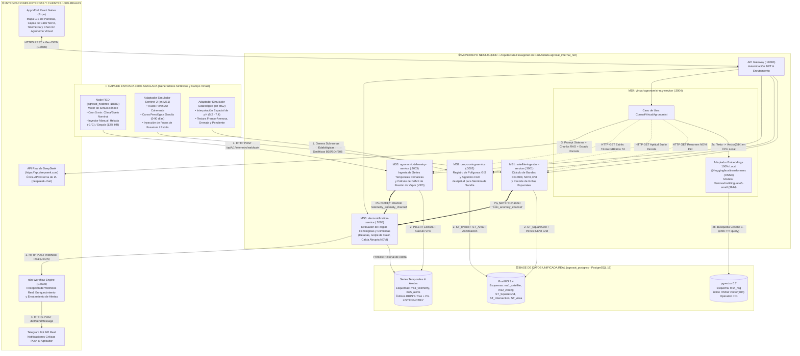
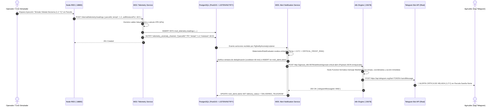
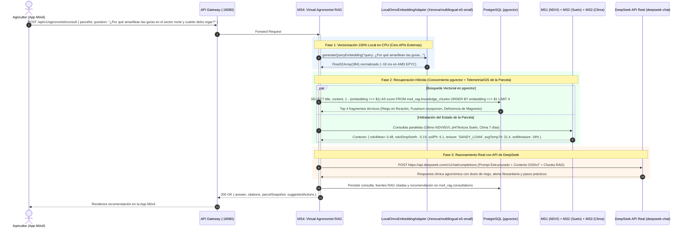
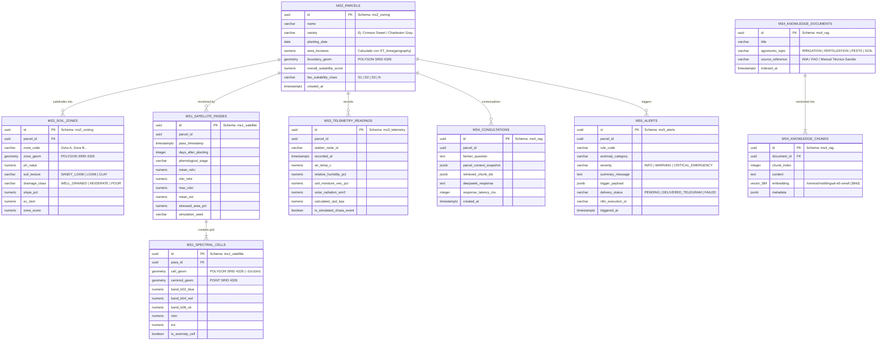

# 🍉 AgroSat AI — Arquitectura de Software y Diseño Técnico
**Teledetección y Monitoreo Agrícola Inteligente para el Cultivo de Sandía (*Citrullus lanatus*)**

---

## 1. Visión Arquitectónica y Matriz de Alcance (Simulado vs. Real)

**AgroSat AI** es una plataforma distribuida basada en **Microservicios (Monorepo en Node.js + NestJS + TypeScript)** diseñada bajo los principios de **Domain-Driven Design (DDD)** y **Arquitectura Hexagonal (Puertos y Adaptadores)**.

Gracias al principio de **Inversión de Dependencias**, el dominio agronómico y los casos de uso son completamente agnósticos del origen de los datos. Esto permite operar el sistema bajo un modelo híbrido donde las fuentes físicas de campo y orbitales son **100% simuladas mediante modelos matemáticos realistas**, mientras que el motor geoespacial, la base de datos vectorial, la generación de embeddings locales, el razonamiento con Inteligencia Artificial y la orquestación de alertas operan con **tecnología 100% real en producción**.

### 1.1 Matriz de Frontera: Simulación vs. Procesamiento Real

| Capa / Subsistema | Naturaleza | Implementación Técnica en AgroSat AI |
| :--- | :---: | :--- |
| **Pasadas Satelitales Sentinel-2 / Copernicus** | 🧪 **100% Simulado** | Adaptador `PerlinNoiseSpectralSimulatorAdapter` en `MS1`: genera bandas sintéticas `B04` (Rojo), `B08` (NIR) y `B02` (Azul) usando **Ruido Perlin 2D coherente** modulado por la curva fenológica de 90 días de la sandía y focos sintéticos de estrés. |
| **Propiedades Edafológicas de Suelo** | 🧪 **100% Simulado** | Adaptador `SyntheticEdaphologyGeneratorAdapter` en `MS2`: simula sub-zonas intraparcelarias con pH (`5.2 - 7.4`), textura (franco-arenosa, arcillosa, limosa), conductividad eléctrica, drenaje y pendiente topográfica. |
| **Sensores Climáticos y de Suelo (IoT)** | 🧪 **100% Simulado** | **Node-RED (`agrosat_nodered`)**: motor de simulación de campo que inyecta series temporales periódicas (temperatura, humedad relativa, humedad volumétrica del suelo, radiación solar) y permite disparar eventos críticos bajo demanda (heladas, golpes de calor, fallos de riego). |
| **Cálculo Geoespacial y Zonificación GIS** | ⚙️ **100% Real** | **PostgreSQL 16 + PostGIS 3.4**: uso real de `ST_Area`, `ST_SquareGrid`, `ST_Clip`, `ST_Intersects`, `ST_Centroid`, `ST_Within` y geometrías `SRID 4326` (WGS84). |
| **Generación de Embeddings para RAG** | ⚙️ **100% Real (Local)** | **ONNX Runtime en Node.js (`@huggingface/transformers`)** dentro de `MS4`: ejecuta localmente el modelo multilingüe `Xenova/multilingual-e5-small` (`vector(384)`) sobre los 6 vCPUs del VPS, con caché persistente en disco y **cero APIs externas de embeddings**. |
| **Búsqueda Vectorial Semántica** | ⚙️ **100% Real** | **PostgreSQL 16 + `pgvector`**: índices `HNSW` (`vector_cosine_ops`) y consultas reales de similitud coseno (`1 - (embedding <=> $1)`) sobre manuales técnicos del cultivo de sandía. |
| **Razonamiento Agronómico (LLM)** | ⚙️ **100% Real** | **API Oficial de DeepSeek (`https://api.deepseek.com`)**: consumida vía SDK compatible con OpenAI en `MS4` (`deepseek-chat` / `deepseek-reasoner`), siendo la **única API externa de IA** del proyecto. |
| **Orquestación y Envío de Alertas** | ⚙️ **100% Real** | **n8n (`agrosat_n8n`) + Telegram Bot API**: disparo de Webhooks HTTP reales desde `MS5` hacia `n8n`, formateo enriquecido y entrega push real al teléfono del agricultor en Telegram. |

---

## 2. Estructura del Monorepo (NestJS + Aplicaciones + Simulación + Infra)

El proyecto se organiza en un **Monorepo gestionado con NestJS CLI Workspaces y npm/pnpm workspaces**, garantizando límites estrictos entre microservicios y reutilización tipada a través de `libs/`:

```text
ProyectoFT4/
├── apps/
│   ├── api-gateway/                                  # BFF / Reverse Proxy de Aplicación, Auth JWT, Swagger Unificado (:18080)
│   │   └── src/
│   │       ├── main.ts
│   │       ├── gateway.module.ts
│   │       └── proxies/                              # Enrutamiento hacia MS1..MS5
│   │
│   ├── ms1-satellite-ingestion-service/              # MS1: Simulación Sentinel-2, Ruido Perlin 2D y Grillas NDVI/EVI PostGIS (:3001)
│   │   └── src/
│   │       ├── domain/
│   │       │   ├── entities/
│   │       │   │   ├── satellite-pass.entity.ts
│   │       │   │   └── spectral-grid-cell.entity.ts
│   │       │   ├── value-objects/
│   │       │   │   ├── ndvi-value.vo.ts              # Rango [-1.0, +1.0] con clasificación de vigor en sandía
│   │       │   │   ├── evi-value.vo.ts
│   │       │   │   ├── phenological-stage.vo.ts      # EMERGENCE | VINE_GROWTH | FLOWERING_FRUIT_SET | MATURATION
│   │       │   │   └── spectral-bands.vo.ts          # B02 (Blue), B04 (Red), B08 (NIR)
│   │       │   └── exceptions/
│   │       │       └── invalid-spectral-band.exception.ts
│   │       ├── application/
│   │       │   ├── use-cases/
│   │       │   │   ├── simulate-satellite-pass.use-case.ts
│   │       │   │   ├── get-parcel-heatmap-grid.use-case.ts
│   │       │   │   └── get-ndvi-time-series.use-case.ts
│   │       │   ├── ports/
│   │       │   │   ├── in/                           # Interfaces de casos de uso
│   │       │   │   └── out/
│   │       │   │       ├── satellite-simulator.port.ts
│   │       │   │       ├── spectral-grid-repository.port.ts
│   │       │   │       └── anomaly-event-publisher.port.ts
│   │       │   └── dtos/
│   │       └── infrastructure/
│   │           ├── controllers/
│   │           │   └── satellite-ingestion.controller.ts
│   │           ├── persistence/
│   │           │   └── postgis-spectral-grid.repository.ts
│   │           ├── simulators/
│   │           │   └── perlin-noise-sentinel2.adapter.ts
│   │           └── messaging/
│   │               └── pg-notify-anomaly.publisher.ts
│   │
│   ├── ms2-crop-zoning-service/                      # MS2: Delimitación de Polígonos GIS y Aptitud Edafológica para Sandía (:3002)
│   │   └── src/
│   │       ├── domain/
│   │       │   ├── entities/
│   │       │   │   ├── parcel-polygon.entity.ts
│   │       │   │   └── soil-suitability-zone.entity.ts
│   │       │   ├── value-objects/
│   │       │   │   ├── soil-ph.vo.ts                 # Óptimo sandía: 5.8 - 6.6
│   │       │   │   ├── soil-texture.vo.ts            # SANDY_LOAM | LOAM | CLAY_LOAM | CLAY
│   │       │   │   ├── drainage-class.vo.ts          # WELL_DRAINED | MODERATE | POOR
│   │       │   │   ├── slope-percentage.vo.ts        # Óptimo < 5%
│   │       │   │   └── watermelon-suitability-score.vo.ts # Score [0-100] y categoría (S1, S2, S3, N) FAO
│   │       │   └── exceptions/
│   │       │       └── self-intersecting-polygon.exception.ts
│   │       ├── application/
│   │       │   ├── use-cases/
│   │       │   │   ├── register-parcel-polygon.use-case.ts
│   │       │   │   ├── evaluate-watermelon-suitability.use-case.ts
│   │       │   │   └── get-parcel-zoning-map.use-case.ts
│   │       │   ├── ports/
│   │       │   │   ├── in/
│   │       │   │   └── out/
│   │       │   │       ├── parcel-spatial-repository.port.ts
│   │       │   │       └── edaphological-simulator.port.ts
│   │       │   └── dtos/
│   │       └── infrastructure/
│   │           ├── controllers/
│   │           │   └── crop-zoning.controller.ts
│   │           ├── persistence/
│   │           │   └── postgis-parcel-zoning.repository.ts
│   │           └── simulators/
│   │               └── synthetic-edaphology.adapter.ts
│   │
│   ├── ms3-agronomic-telemetry-service/              # MS3: Ingesta de Series Temporales Climáticas y de Suelo desde Node-RED (:3003)
│   │   └── src/
│   │       ├── domain/
│   │       │   ├── entities/
│   │       │   │   ├── telemetry-reading.entity.ts
│   │       │   │   └── iot-sensor-station.entity.ts
│   │       │   ├── value-objects/
│   │       │   │   ├── air-temperature.vo.ts         # Crítico en sandía: < 10°C detención, < 2°C helada, > 38°C aborto floral
│   │       │   │   ├── volumetric-soil-moisture.vo.ts
│   │       │   │   ├── relative-humidity.vo.ts
│   │       │   │   └── vapor-pressure-deficit.vo.ts  # Cálculo real de VPD (kPa)
│   │       │   └── exceptions/
│   │       ├── application/
│   │       │   ├── use-cases/
│   │       │   │   ├── ingest-telemetry-reading.use-case.ts
│   │       │   │   └── get-parcel-telemetry-summary.use-case.ts
│   │       │   ├── ports/
│   │       │   │   ├── in/
│   │       │   │   └── out/
│   │       │   │       ├── telemetry-timeseries-repository.port.ts
│   │       │   │       └── telemetry-event-publisher.port.ts
│   │       │   └── dtos/
│   │       └── infrastructure/
│   │           ├── controllers/
│   │           │   └── nodered-telemetry-webhook.controller.ts
│   │           ├── persistence/
│   │           │   └── postgres-telemetry.repository.ts
│   │           └── messaging/
│   │               └── pg-notify-telemetry.publisher.ts
│   │
│   ├── ms4-virtual-agronomist-rag-service/           # MS4: Motor RAG (pgvector + ONNX Local) + DeepSeek API Real (:3004)
│   │   └── src/
│   │       ├── domain/
│   │       │   ├── entities/
│   │       │   │   ├── agronomic-consultation.entity.ts
│   │       │   │   ├── knowledge-chunk.entity.ts
│   │       │   │   └── agronomic-prescription.entity.ts
│   │       │   ├── value-objects/
│   │       │   │   ├── embedding-vector.vo.ts        # Float32Array(384) normalizado L2
│   │       │   │   └── parcel-holistic-context.vo.ts # Agregación de MS1 (NDVI) + MS2 (Suelo) + MS3 (Clima)
│   │       │   └── exceptions/
│   │       ├── application/
│   │       │   ├── use-cases/
│   │       │   │   ├── consult-virtual-agronomist.use-case.ts
│   │       │   │   └── ingest-watermelon-manual.use-case.ts
│   │       │   ├── ports/
│   │       │   │   ├── in/
│   │       │   │   └── out/
│   │       │   │       ├── embedding-generator.port.ts     # Puerto desacoplado de Embeddings
│   │       │   │       ├── llm-reasoning.port.ts           # Puerto desacoplado de Generación de Texto (LLM)
│   │       │   │       ├── vector-knowledge-repository.port.ts
│   │       │   │       └── parcel-context-aggregator.port.ts
│   │       │   └── dtos/
│   │       └── infrastructure/
│   │           ├── controllers/
│   │           │   └── virtual-agronomist.controller.ts
│   │           ├── ai-adapters/
│   │           │   ├── local-onnx-embedding.adapter.ts     # @huggingface/transformers (Xenova/multilingual-e5-small) 100% Local
│   │           │   └── deepseek-openai-llm.adapter.ts      # OpenAI SDK apuntando a https://api.deepseek.com
│   │           ├── persistence/
│   │           │   └── pgvector-knowledge.repository.ts
│   │           └── http-clients/
│   │               └── internal-microservices-context.adapter.ts
│   │
│   ├── ms5-alert-notification-service/               # MS5: Reglas Agronómicas y Despacho Webhook Real hacia n8n -> Telegram (:3005)
│   │   └── src/
│   │       ├── domain/
│   │       │   ├── entities/
│   │       │   │   ├── agronomic-alert.entity.ts
│   │       │   │   └── alert-threshold-rule.entity.ts
│   │       │   ├── value-objects/
│   │       │   │   ├── alert-severity.vo.ts          # INFO | WARNING | CRITICAL_EMERGENCY
│   │       │   │   └── anomaly-category.vo.ts        # FROST_RISK | WATER_STRESS | HEAT_SHOCK | SUDDEN_NDVI_DROP
│   │       │   └── services/
│   │       │       └── watermelon-rule-evaluator.domain-service.ts
│   │       ├── application/
│   │       │   ├── use-cases/
│   │       │   │   ├── evaluate-telemetry-anomaly.use-case.ts
│   │       │   │   ├── evaluate-spectral-anomaly.use-case.ts
│   │       │   │   └── list-parcel-alerts.use-case.ts
│   │       │   ├── ports/
│   │       │   │   ├── in/
│   │       │   │   └── out/
│   │       │   │       ├── notification-webhook.port.ts
│   │       │   │       └── alert-repository.port.ts
│   │       │   └── dtos/
│   │       └── infrastructure/
│   │           ├── controllers/
│   │           │   └── alert-notification.controller.ts
│   │           ├── listeners/
│   │           │   └── pg-notify-anomaly.listener.ts
│   │           ├── webhooks/
│   │           │   └── n8n-alert-webhook.adapter.ts  # Disparo HTTP POST real hacia agrosat_n8n (:5678)
│   │           └── persistence/
│   │               └── postgres-alert.repository.ts
│   │
│   └── mobile-app/                                   # Frontend Móvil Multiplataforma (React Native + Expo)
│       ├── app/                                      # Expo Router (Pantallas: Mapa GIS, Telemetría, Chat IA, Alertas)
│       ├── src/
│       │   ├── components/
│       │   │   ├── ParcelPolygonMap.tsx              # Renderizado de polígonos y celdas de calor NDVI (react-native-maps)
│       │   │   ├── SoilSuitabilityCard.tsx
│       │   │   ├── TelemetryChart.tsx
│       │   │   └── AgronomistChatBubble.tsx
│       │   ├── services/
│       │   │   └── agrosat-api.client.ts
│       │   └── store/
│       └── app.json
│
├── libs/
│   ├── shared-kernel/                                # Primitivas DDD (Entity, AggregateRoot, ValueObject, Result<T>, DomainError)
│   ├── gis-contracts/                                # Tipos GeoJSON (Polygon, FeatureCollection, BoundingBox) y utilidades SRID 4326
│   └── service-contracts/                            # Contratos de eventos internos (Payloads PG LISTEN/NOTIFY y DTOs inter-servicio)
│
├── tools/
│   └── simulators/
│       ├── seed-watermelon-kb/                       # Corpus técnico de cultivo de sandía (Markdown/JSON) + CLI de vectorización
│       ├── perlin-ndvi-cli/                          # Script CLI para simular evolución fenológica completa (90 días) o plagas
│       ├── node-red/
│       │   └── flows.json                            # Flujos exportados: Telemetría nominal + Botones de Caos (Helada, Sequía, Golpe de Calor)
│       └── n8n/
│           └── telegram-watermelon-alerts.json       # Workflow n8n exportado: Webhook -> Formateo Agronómico -> Telegram Bot API
│
├── infra/
│   └── docker/
│       ├── postgres/
│       │   ├── Dockerfile.postgis-pgvector           # Imagen unificada PostgreSQL 16 + PostGIS 3.4 + pgvector 0.7
│       │   └── 01-init-db.sql                        # Extensiones postgis, vector y creación de los 5 esquemas (ms1..ms5)
│       ├── Dockerfile.nestjs-alpine                  # Multi-stage ligero para Gateway, MS1, MS2, MS3 y MS5
│       └── Dockerfile.ms4-onnx                       # Multi-stage basado en node:20-bookworm-slim (glibc) para ONNX Runtime nativo
│
├── docker-compose.yml
├── nest-cli.json
├── package.json
├── tsconfig.base.json
├── ARCHITECTURE.md
├── DOCKER_PLAN.md                                    # Incluye los Prompts de Operación para el Agente del VPS (vmi3599358)
└── ROADMAP.md
```

---

## 3. Diagramas de Arquitectura y Flujo de Datos (Mermaid)

### 3.1 Diagrama General de Arquitectura Híbrida y Flujo de Datos

El siguiente diagrama ilustra cómo se inyectan los datos desde los generadores sintéticos (`Node-RED`, `PerlinNoiseAdapter` y `SyntheticEdaphologyAdapter`) hacia el núcleo real de **PostGIS**, **`pgvector` (con ONNX Local)**, **DeepSeek API**, **n8n** y **Telegram Bot API**:



---

### 3.2 Diagrama de Secuencia: Flujo Reactivo de Anomalías (Node-RED / MS1 $\rightarrow$ MS5 $\rightarrow$ n8n $\rightarrow$ Telegram)



---

### 3.3 Diagrama de Secuencia: Agrónomo Virtual RAG (ONNX Local + `pgvector` + DeepSeek API)



---

## 4. Diseño Detallado de los 5 Microservicios (DDD + Arquitectura Hexagonal)

Cada microservicio aplica estrictamente la regla de dependencia concéntrica:
$$\text{Infrastructure (Adaptadores)} \longrightarrow \text{Application (Casos de Uso y Puertos)} \longrightarrow \text{Domain (Entidades y Reglas Puras)}$$

Ninguna clase dentro de `src/domain/` ni `src/application/` importa decoradores de base de datos, librerías HTTP externas, SDKs de IA ni tipos de infraestructura.

---

### 4.1 MS1: `satellite-ingestion-service` (Teledetección Sintética y Grillas PostGIS)

#### Propósito de Dominio
Simular pasadas orbitales del satélite **Sentinel-2 (resolución espacial adaptada de 10m x 10m por celda)** sobre los polígonos de parcelas registrados, calculando los índices espectrales **NDVI** (*Normalized Difference Vegetation Index*) y **EVI** (*Enhanced Vegetation Index*) mediante funciones espaciales de PostGIS y generadores matemáticos deterministas por semilla.

#### Modelo Matemático de Simulación para Sandía (*Citrullus lanatus*)
1. **Subdivisión Espacial Real en PostGIS**:
   Al solicitar una pasada satelital sobre una parcela con geometría $G$ (`SRID 4326`), el repositorio ejecuta en PostGIS:
   ```sql
   SELECT
     ST_SetSRID(grid.geom, 4326) AS cell_geom,
     ST_X(ST_Centroid(grid.geom)) AS lon,
     ST_Y(ST_Centroid(grid.geom)) AS lat
   FROM ST_SquareGrid(0.0001, ST_Envelope($1::geometry)) AS grid
   WHERE ST_Intersects(grid.geom, $1::geometry);
   ```
   *(Donde `0.0001` grados equivale aproximadamente a celdas de $11\text{m} \times 11\text{m}$ en latitudes tropicales/subtropicales).*

2. **Curva Fenológica Base de la Sandía ($\text{NDVI}_{\text{base}}(t)$)**:
   En función de los **Días Después del Trasplante/Siembra ($\text{DAS} \in [0, 90]$)**:
   - **Etapa 1 — Emergencia y Establecimiento ($0 - 18 \text{ DAS}$)**: $\text{NDVI}_{\text{base}} \in [0.14, 0.26]$ (predominio de suelo desnudo/acolchado plástico).
   - **Etapa 2 — Crecimiento Rápido de Guías ($19 - 40 \text{ DAS}$)**: $\text{NDVI}_{\text{base}} \in [0.28, 0.64]$ (expansión foliar acelerada).
   - **Etapa 3 — Floración, Polinización y Cuajado ($41 - 65 \text{ DAS}$)**: $\text{NDVI}_{\text{base}} \in [0.65, 0.84]$ (máxima cobertura fotosintética del dosel).
   - **Etapa 4 — Llenado de Fruto y Maduración ($66 - 90 \text{ DAS}$)**: $\text{NDVI}_{\text{base}} \in [0.52, 0.68]$ (senescencia foliar natural previa a cosecha).

3. **Modulación Espacial con Ruido Perlin 2D y Focos de Estrés**:
   Para cada celda $(x, y)$ de la grilla PostGIS en el día $t$:
   $$\text{NDVI}(x, y, t) = \text{clamp}\Big(\text{NDVI}_{\text{base}}(t) + \alpha \cdot \text{Perlin2D}(x \cdot f_s, y \cdot f_s, \text{seed}) - \Delta_{\text{estrés}}(x, y, t),\; -0.1,\; 0.92\Big)$$
   A partir del $\text{NDVI}(x, y, t)$ objetivo y una reflectancia base en el infrarrojo cercano ($B_{08} \in [0.35, 0.55]$), el simulador despeja físicamente la banda roja $B_{04}$:
   $$B_{04} = B_{08} \cdot \frac{1 - \text{NDVI}}{1 + \text{NDVI}}$$
   Y luego el **Dominio Puro** calcula y verifica las fórmulas estándar:
   $$\text{NDVI} = \frac{B_{08} - B_{04}}{B_{08} + B_{04}}, \qquad \text{EVI} = 2.5 \cdot \frac{B_{08} - B_{04}}{B_{08} + 6 \cdot B_{04} - 7.5 \cdot B_{02} + 1}$$

#### Estructura Hexagonal de `MS1`
- **Domain**:
  - `SatellitePass` (Aggregate Root), `SpectralGridCell` (Entity).
  - `NdviValue`, `EviValue`, `SpectralBands`, `WatermelonPhenologicalStage` (Value Objects).
- **Application Ports**:
  - `In`: `SimulateSatellitePassUseCase`, `GetParcelSpectralGridUseCase`, `InjectLocalizedPestStressUseCase`.
  - `Out`: `SatelliteSpectralSimulatorPort`, `SpectralPassRepositoryPort`, `AnomalyEventPublisherPort`.
- **Infrastructure Adapters**:
  - `PerlinNoiseSentinel2Adapter` (implementa `SatelliteSpectralSimulatorPort`).
  - `PostgisSpectralGridRepository` (persiste geometrías `POLYGON` de cada celda y estadísticas agregadas).
  - `PgNotifyAnomalyPublisher` (emite evento a `MS5` cuando el porcentaje de celdas con caída $\Delta\text{NDVI} \le -0.15$ supera el $15\%$ de la parcela).

---

### 4.2 MS2: `crop-zoning-service` (Polígonos Geoespaciales y Aptitud Edafológica para Sandía)

#### Propósito de Dominio
Gestionar el catastro geoespacial de las parcelas agrícolas y evaluar la **aptitud edafológica y topográfica del terreno para la siembra de sandía**, subdividiendo el polígono en zonas de manejo homogéneo (*Management Zones*).

#### Criterios Agronómicos de Aptitud para Sandía (Reglas de Dominio)
El Servicio de Dominio `WatermelonSoilSuitabilityCalculator` califica cada sub-zona en un puntaje de $0$ a $100$ y la clasifica según el estándar FAO (`S1: Altamente Apto`, `S2: Moderadamente Apto`, `S3: Marginalmente Apto`, `N: No Apto`):

| Parámetro Edafológico | Peso (%) | Rango Óptimo (`S1`: 90-100 pts) | Rango Moderado (`S2`: 60-89 pts) | Condición Limitante Crítica (`S3`/`N`: < 60 pts) |
| :--- | :---: | :--- | :--- | :--- |
| **pH del Suelo** | **30%** | `5.8 – 6.6` (Ligeramente ácido, ideal para asimilación de micronutrientes) | `5.3 – 5.7` o `6.7 – 7.2` | `< 5.0` (toxicidad por Al) o `> 7.5` (bloqueo de Hierro/Zinc) |
| **Textura Edáfica** | **25%** | **Franco-Arenosa (`SANDY_LOAM`)** (calentamiento rápido primaveral y desarrollo radicular) | Franca (`LOAM`) o Arenoso-Franca (`LOAMY_SAND`) | Arcillosa pesada (`CLAY`) — compactación y asfixia radicular |
| **Capacidad de Drenaje** | **25%** | **Bueno (`WELL_DRAINED`)** | Moderado (`MODERATE`) | Deficiente (`POOR`) — alto riesgo de *Phytophthora* y *Pythium* en cuello |
| **Pendiente Topográfica** | **10%** | `< 2.5%` | `2.5% – 5.0%` | `> 8.0%` (erosión hídrica y desuniformidad en riego por goteo) |
| **Conductividad Eléctrica ($CE_e$)** | **10%** | `< 2.0 dS/m` | `2.0 – 3.5 dS/m` | `> 4.0 dS/m` (reducción drástica del calibre del fruto) |

#### Estructura Hexagonal de `MS2`
- **Domain**:
  - `ParcelPolygon` (Aggregate Root), `SoilSuitabilityZone` (Entity).
  - `SoilPh`, `SoilTexture`, `DrainageClass`, `SlopePercentage`, `ElectricalConductivity`, `WatermelonSuitabilityScore` (Value Objects).
- **Application Ports**:
  - `In`: `RegisterParcelUseCase`, `EvaluateParcelSuitabilityUseCase`, `GetParcelGeoJsonUseCase`.
  - `Out`: `ParcelSpatialRepositoryPort`, `EdaphologicalSimulatorPort`.
- **Infrastructure Adapters**:
  - `PostgisParcelZoningRepository` (valida topología con `ST_IsValid`, calcula superficie exacta en hectáreas con `ST_Area(geom::geography) / 10000.0` y divide la parcela en sub-polígonos de manejo).
  - `SyntheticEdaphologyAdapter` (genera gradientes espaciales coherentes de pH, textura y drenaje sobre las sub-zonas de la parcela).

---

### 4.3 MS3: `agronomic-telemetry-service` (Series Temporales Climáticas e IoT con Node-RED)

#### Propósito de Dominio
Recibir, validar, enriquecer y almacenar las series temporales de telemetría agrometeorológica y de suelo enviadas por **Node-RED**, calculando indicadores derivados en tiempo real como el **Déficit de Presión de Vapor ($\text{VPD}$)** y la **acumulación de Grados-Día de Crecimiento ($\text{GDD}$, temperatura base $T_{\text{base}} = 12^\circ\text{C}$ para sandía)**.

#### Fórmulas de Dominio en `MS3`
- **Presión de Vapor de Saturación ($e_s$, ecuación de Tetens)**:
  $$e_s(T) = 0.61078 \cdot \exp\left(\frac{17.27 \cdot T}{T + 237.3}\right) \text{ [kPa]}$$
- **Déficit de Presión de Vapor ($\text{VPD}$)**:
  $$\text{VPD} = e_s(T) \cdot \left(1 - \frac{\text{HR}}{100}\right) \text{ [kPa]}$$
  *(En sandía, un $\text{VPD} > 2.2\text{ kPa}$ indica cierre estomático severo y estrés transpiratorio; un $\text{VPD} < 0.3\text{ kPa}$ favorece condensación foliar y ataque de Mildiu velloso — *Pseudoperonospora cubensis*).*

#### Estructura Hexagonal de `MS3`
- **Domain**:
  - `TelemetryReading` (Entity), `IotSensorStation` (Aggregate Root).
  - `AirTemperature`, `RelativeHumidity`, `VolumetricSoilMoisture`, `VaporPressureDeficit` (Value Objects).
- **Application Ports**:
  - `In`: `IngestTelemetryReadingUseCase`, `GetTelemetryWindowStatsUseCase`.
  - `Out`: `TelemetryTimeSeriesRepositoryPort`, `TelemetryAnomalyPublisherPort`.
- **Infrastructure Adapters**:
  - `NodeRedTelemetryWebhookController` (endpoint `POST /api/v1/telemetry/ingest` consumido por `agrosat_nodered`).
  - `PostgresTelemetryRepository` (almacenamiento optimizado con índices compuestos `(parcel_id, recorded_at DESC)`).
  - `PgNotifyTelemetryPublisher` (publica lecturas fuera de rango nominal en el canal `telemetry_anomaly_channel`).

---

### 4.4 MS4: `virtual-agronomist-rag-service` (Motor RAG en `pgvector` + ONNX Local + DeepSeek API)

#### Propósito de Dominio
Actuar como un **Agrónomo Especialista en Cucurbitáceas**, combinando recuperación semántica sobre manuales técnicos vectorizados en `pgvector` con el estado cuantitativo actual de la parcela (NDVI de `MS1` + Suelo de `MS2` + Clima de `MS3`) para generar diagnósticos y prescripciones accionables mediante la **API real de DeepSeek**.

#### Separación Estricta de Puertos de IA (Embeddings Local vs. Razonamiento DeepSeek)
En cumplimiento de la directriz arquitectónica de **Cero APIs Externas de Embeddings**, `MS4` define dos puertos de salida completamente independientes en su capa `application/ports/out/`:

```typescript
// 1. Puerto de Generación de Embeddings (Implementado 100% en CPU Local con ONNX)
export interface EmbeddingGeneratorPort {
  generateDocumentEmbedding(text: string): Promise<number[]>; // Prefijo "passage: " para E5
  generateQueryEmbedding(query: string): Promise<number[]>;   // Prefijo "query: " para E5
  getDimensions(): number;                                    // 384 dimensiones
}

// 2. Puerto de Razonamiento Agronómico (Implementado con API Real de DeepSeek)
export interface LlmReasoningPort {
  generateAgronomicPrescription(params: {
    farmerQuestion: string;
    holisticParcelContext: ParcelHolisticContextDto;
    retrievedKnowledgeChunks: RetrievedChunkDto[];
  }): Promise<AgronomicPrescriptionResult>;
}
```

#### Detalles Técnicos de los Adaptadores de IA en `MS4`
1. **`LocalOnnxEmbeddingAdapter` (`@huggingface/transformers`)**:
   - Utiliza el pipeline `feature-extraction` con el modelo **`Xenova/multilingual-e5-small`** (`quantized: true`, 384 dimensiones).
   - Al ejecutarse sobre los **6 vCPUs AMD EPYC** del VPS `vmi3599358` en un contenedor `node:20-bookworm-slim` (`glibc`) con caché montado en `/app/.cache/huggingface`, el modelo se carga en RAM una sola vez al iniciar el microservicio (`OnModuleInit`) y vectoriza cada consulta del agricultor en **$15\text{ ms} - 25\text{ ms}$**, sin latencia de red ni costos por token.
2. **`DeepSeekOpenAiLlmAdapter` (`openai` SDK oficial)**:
   - Configura el cliente oficial `new OpenAI({ baseURL: 'https://api.deepseek.com', apiKey: process.env.DEEPSEEK_API_KEY })`.
   - Utiliza el modelo `deepseek-chat` (DeepSeek-V3) con `temperature: 0.2` para garantizar rigor técnico agronómico y salidas estructuradas en Markdown/JSON comprensibles para el agricultor.

---

### 4.5 MS5: `alert-notification-service` (Motor de Reglas Agronómicas y Despacho Real a n8n + Telegram)

#### Propósito de Dominio
Evaluar en tiempo real las anomalías detectadas en las pasadas satelitales (`MS1`) y en el flujo de telemetría IoT (`MS3`), aplicando ventanas de enfriamiento (*cooldown* anti-spam) y disparando **Webhooks HTTP reales hacia `n8n`**, el cual formatea y entrega la alerta al agricultor vía **Telegram Bot API**.

#### Catálogo de Reglas de Negocio para Cultivo de Sandía en `MS5`

| Código de Regla | Fuente | Condición de Disparo | Severidad | Acción Recomendada en la Alerta de Telegram |
| :--- | :---: | :--- | :---: | :--- |
| **`RULE_FROST_CRITICAL`** | `MS3` (Node-RED) | $T_{\text{aire}} \le 2.0^\circ\text{C}$ | 🚨 `CRITICAL_EMERGENCY` | Activar riego por microaspersión/goteo continuo por calor latente y verificar túneles térmicos. |
| **`RULE_CHILLING_INJURY`** | `MS3` (Node-RED) | $2.0^\circ\text{C} < T_{\text{aire}} \le 9.5^\circ\text{C}$ durante $> 2$ lecturas | ⚠️ `WARNING` | Estrés por frío: detención del crecimiento vegetativo. Programar aplicación de aminoácidos/bioestimulantes. |
| **`RULE_FLOWER_ABORT_HEAT`** | `MS3` (Node-RED) | $T_{\text{aire}} \ge 38.0^\circ\text{C}$ y $\text{HR} < 25\%$ en etapa de Floración | 🚨 `CRITICAL_EMERGENCY` | Riesgo de deshidratación de polen y aborto floral. Aplicar pulso de riego de refrescamiento inmediato. |
| **`RULE_WATER_DEFICIT_FRUIT`** | `MS3` (Node-RED) | $\text{Humedad Suelo} < 20\%$ en etapa de Cuajado/Llenado | 🚨 `CRITICAL_EMERGENCY` | Déficit hídrico crítico: alto riesgo de *Blossom-End Rot* (pudrición apical por falta de transporte de Calcio). |
| **`RULE_SUDDEN_NDVI_DROP`** | `MS1` (Satélite) | $\Delta\text{NDVI}_{\text{media}} \le -0.15$ respecto a pasada anterior o $> 18\%$ de celdas en rojo | 🚨 `CRITICAL_EMERGENCY` | Posible marchitez vascular (*Fusarium oxysporum*) o rotura de cintilla de riego en el sector afectado (incluye coordenadas del centroide del foco). |

---

## 5. Modelo de Datos Unificado (PostgreSQL 16 + `PostGIS 3.4` + `pgvector 0.7`)

Para preservar la autonomía de cada microservicio bajo DDD sin multiplicar el consumo de memoria RAM en el VPS, todos los servicios comparten el contenedor `agrosat_postgres` pero están **aislados lógicamente en 5 esquemas independientes**:



### Índices Espaciales y Vectoriales Clave (`01-init-db.sql`)
```sql
-- Extensiones Reales en PostgreSQL 16
CREATE EXTENSION IF NOT EXISTS postgis;
CREATE EXTENSION IF NOT EXISTS vector;

-- Esquemas por Microservicio
CREATE SCHEMA IF NOT EXISTS ms1_satellite;
CREATE SCHEMA IF NOT EXISTS ms2_zoning;
CREATE SCHEMA IF NOT EXISTS ms3_telemetry;
CREATE SCHEMA IF NOT EXISTS ms4_rag;
CREATE SCHEMA IF NOT EXISTS ms5_alerts;

-- Índice Espacial GIST para consultas de intersección y mapas de calor en MS1 y MS2
CREATE INDEX idx_ms2_parcels_geom ON ms2_zoning.parcels USING GIST (boundary_geom);
CREATE INDEX idx_ms1_cells_geom ON ms1_satellite.spectral_cells USING GIST (cell_geom);

-- Índice Vectorial HNSW en pgvector para búsqueda semántica ultrarrápida (384 dimensiones) en MS4
CREATE INDEX idx_ms4_chunks_embedding_hnsw
  ON ms4_rag.knowledge_chunks
  USING hnsw (embedding vector_cosine_ops)
  WITH (m = 16, ef_construction = 64);
```

---

## 6. Arquitectura del Frontend Móvil (`apps/mobile-app`)

La aplicación móvil en **React Native (Expo SDK 51+ con TypeScript y Expo Router)** se estructura en 4 módulos funcionales conectados exclusivamente al `API Gateway (:18080)`:

1. **Módulo GIS de Parcelas y Zonificación (`features/map-zoning`)**:
   - Usa `react-native-maps` con proveedor Google Maps / Mapbox en vista satelital híbrida.
   - Permite al agricultor trazar los vértices de su parcela en pantalla, enviando las coordenadas al `MS2` para recibir instantáneamente el área en hectáreas (`ST_Area`) y la capa coloreada de **Aptitud de Suelo para Sandía (`S1` Verde, `S2` Amarillo, `S3` Naranja, `N` Rojo)**.
   - Superpone la grilla de polígonos GeoJSON de `MS1` (`<Polygon />` por celda de $10\text{m} \times 10\text{m}$ con escala cromática continua de NDVI desde rojo `0.15` hasta verde intenso `0.85`).
2. **Módulo de Monitoreo Climático e Hídrico (`features/telemetry-dashboard`)**:
   - Visualiza las series temporales inyectadas por Node-RED en `MS3`: Temperatura, Humedad Volumétrica del Suelo y el indicador de **VPD (Déficit de Presión de Vapor)** con franjas de confort para la sandía.
3. **Módulo de Agrónomo Virtual IA (`features/virtual-agronomist`)**:
   - Interfaz conversacional donde el agricultor selecciona su parcela y realiza preguntas en lenguaje natural.
   - Muestra las tarjetas de contexto utilizadas por `MS4` (NDVI actual, etapa fenológica, humedad de suelo y fragmentos citados de los manuales técnicos en `pgvector`) junto con la recomendación generada por **DeepSeek API**.
4. **Módulo de Centro de Alertas y Vinculación con Telegram (`features/alerts-center`)**:
   - Lista el historial de incidentes detectados por `MS5` (heladas, sequías, caídas de NDVI) e incluye un botón de *Deep Link* (`tg://resolve?domain=AgroSatWatermelonBot`) para recibir las notificaciones reales despachadas por `n8n`.
