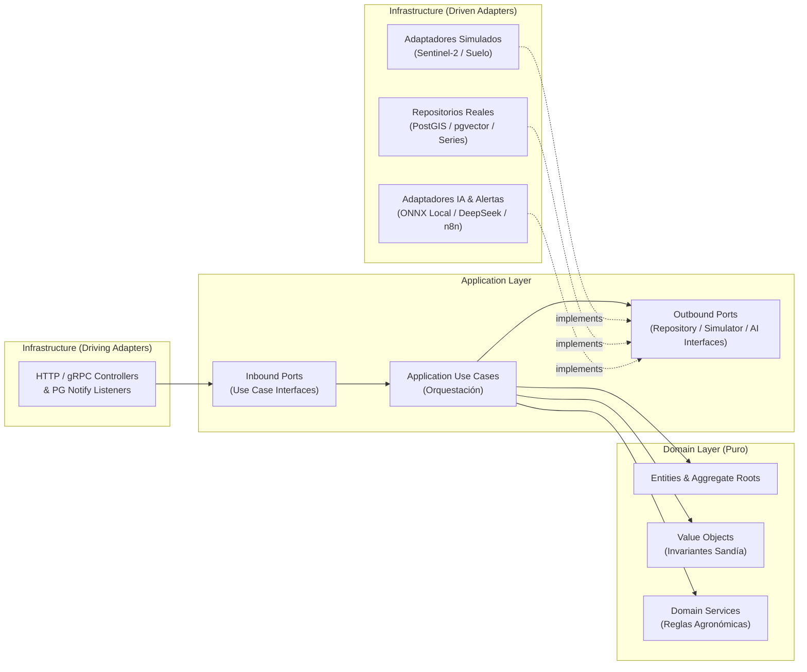

# ⚙️ AgroSat AI — Especificación Técnica de Microservicios Backend (`BACKEND_SPEC.md`)
**Arquitectura Hexagonal + Domain-Driven Design (DDD) en NestJS + TypeScript**

---

## 1. Principios de Diseño y Estructura Canónica por Microservicio

El backend de **AgroSat AI** está compuesto por **5 Microservicios de Dominio** más un **API Gateway (`agrosat_gateway` en `:18080`)** dentro de un Monorepo en NestJS.

Cada microservicio implementa estrictamente **Domain-Driven Design (DDD)** y **Arquitectura Hexagonal (Puertos y Adaptadores)**:
1. **`src/domain/` (Núcleo Puro — Cero Dependencias Externas)**:
   - Contiene **Entidades**, **Agregados**, **Objetos de Valor (Value Objects)**, **Servicios de Dominio**, **Eventos de Dominio** y **Excepciones de Negocio**.
   - **Regla de Oro**: Prohibido importar `@nestjs/*`, `pg`, `typeorm`, `prisma`, `axios`, `openai` o `@huggingface/transformers` dentro de `src/domain/`. Toda la lógica matemática y agronómica de la sandía (*Citrullus lanatus*) vive aquí y es 100% testeable en memoria.
2. **`src/application/` (Orquestación de Casos de Uso y Contratos de Puertos)**:
   - Contiene los **Casos de Uso (`UseCases`)**, **DTOs de Entrada/Salida**, **Puertos Primarios (`ports/in/`)** y **Puertos Secundarios (`ports/out/`)**.
   - Los Puertos Secundarios son interfaces TypeScript puras (`Symbol` injection tokens en NestJS) que abstraen si los datos provienen de un simulador matemático o de un satélite/sensor físico real.
3. **`src/infrastructure/` (Adaptadores Primarios y Secundarios)**:
   - **Adaptadores de Entrada (Driving Adapters)**: Controladores HTTP REST / gRPC y consumidores de eventos PostgreSQL `LISTEN/NOTIFY`.
   - **Adaptadores de Salida (Driven Adapters)**:
     - **Simuladores Sintéticos**: `SimulatedSentinelPostgisAdapter` (`MS1`) y `SimulatedSoilSuitabilityAdapter` (`MS2`).
     - **Persistencia Real**: Repositorios SQL nativos sobre PostgreSQL 16 con funciones espaciales `PostGIS 3.4` y búsqueda vectorial `pgvector 0.7`.
     - **IA e Integraciones Reales**: `LocalTransformersEmbeddingAdapter` (ONNX 384d en CPU local), `DeepSeekLlmAdapter` (API oficial de DeepSeek) y `N8nWebhookAdapter` (alertas reales hacia Telegram).



---

## 2. Microservicio 1: `satellite-ingestion-service` (`MS1` — Puerto Interno `:3001`)

### 2.1 Árbol de Directorios (`apps/ms1-satellite-ingestion-service/src/`)
```text
src/
├── domain/
│   ├── entities/
│   │   ├── sentinel-scene.aggregate.ts          # Escena satelital simulada para una parcela y fecha
│   │   └── spectral-subcell.entity.ts           # Sub-polígono (celda de la grilla) con bandas y NDVI/EVI
│   ├── value-objects/
│   │   ├── spectral-bands.vo.ts                 # Reflectancias B02 (Azul), B04 (Rojo), B08 (NIR) en [0.01, 0.95]
│   │   ├── ndvi-index.vo.ts                     # Valor en [-0.10, 0.85] + clasificación de vigor en sandía
│   │   ├── evi-index.vo.ts                      # Valor de índice de vegetación mejorado
│   │   └── stress-patch-anomaly.vo.ts           # Parámetros de mancha de estrés (centroide lon/lat, radio, severidad)
│   └── exceptions/
│       └── invalid-spectral-range.exception.ts
├── application/
│   ├── ports/
│   │   ├── in/
│   │   │   ├── simulate-sentinel-pass.port.ts
│   │   │   └── query-parcel-ndvi.port.ts
│   │   └── out/
│   │       ├── sentinel-spatial-simulator.port.ts
│   │       ├── sentinel-scene-repository.port.ts
│   │       └── spectral-anomaly-notifier.port.ts
│   ├── use-cases/
│   │   ├── simulate-sentinel-pass.use-case.ts
│   │   ├── inject-stress-patch.use-case.ts
│   │   ├── get-latest-parcel-scene.use-case.ts
│   │   └── get-parcel-ndvi-timeseries.use-case.ts
│   └── dtos/
│       ├── simulate-pass-request.dto.ts
│       └── sentinel-scene-geojson-response.dto.ts
└── infrastructure/
    ├── controllers/
    │   └── satellite-ingestion.controller.ts
    ├── adapters/
    │   ├── simulated-sentinel-postgis.adapter.ts # Generador espacial PostGIS + Ruido Suave + Mancha de Estrés
    │   ├── postgis-scene.repository.ts
    │   └── pg-notify-spectral-anomaly.adapter.ts
    └── ms1.module.ts
```

### 2.2 Esquema Espacial en PostGIS (`ms1_satellite`)

```sql
CREATE SCHEMA IF NOT EXISTS ms1_satellite;

-- 1. Tabla de Escenas Satelitales Simuladas (Sentinel-2 L2A Sintético)
CREATE TABLE ms1_satellite.sentinel_scenes (
    id UUID PRIMARY KEY DEFAULT gen_random_uuid(),
    parcel_id UUID NOT NULL,
    scene_code VARCHAR(64) NOT NULL,                 -- Ej: 'S2B_MSIL2A_20261112_SIM'
    captured_at TIMESTAMPTZ NOT NULL DEFAULT NOW(),
    days_after_planting INT NOT NULL,                -- Día fenológico (0 - 90 días)
    phenological_stage VARCHAR(32) NOT NULL,         -- 'EMERGENCE' | 'VINE_GROWTH' | 'FLOWERING' | 'MATURATION'
    cloud_cover_pct NUMERIC(5,2) NOT NULL DEFAULT 0.0,
    mean_ndvi NUMERIC(5,4) NOT NULL,
    min_ndvi NUMERIC(5,4) NOT NULL,
    max_ndvi NUMERIC(5,4) NOT NULL,
    stddev_ndvi NUMERIC(5,4) NOT NULL,
    mean_evi NUMERIC(5,4) NOT NULL,
    stressed_cells_pct NUMERIC(5,2) NOT NULL DEFAULT 0.0,
    has_stress_patch BOOLEAN NOT NULL DEFAULT FALSE,
    stress_patch_metadata JSONB,                     -- Coordenadas del foco, radio en metros y causa simulada
    created_at TIMESTAMPTZ NOT NULL DEFAULT NOW()
);

CREATE INDEX idx_ms1_scenes_parcel_date
    ON ms1_satellite.sentinel_scenes (parcel_id, captured_at DESC);

-- 2. Tabla de Celdas / Sub-polígonos de la Grilla Espacial (Resolución ~10m x 10m)
CREATE TABLE ms1_satellite.spectral_subcells (
    id UUID PRIMARY KEY DEFAULT gen_random_uuid(),
    scene_id UUID NOT NULL REFERENCES ms1_satellite.sentinel_scenes(id) ON DELETE CASCADE,
    parcel_id UUID NOT NULL,
    cell_row INT NOT NULL,
    cell_col INT NOT NULL,
    cell_geom GEOMETRY(Polygon, 4326) NOT NULL,      -- Sub-polígono recortado con ST_SquareGrid + ST_Intersection
    centroid_geom GEOMETRY(Point, 4326) NOT NULL,    -- Centroide de la celda para cálculo de distancia al foco de estrés
    band_b02_blue NUMERIC(6,5) NOT NULL,
    band_b04_red NUMERIC(6,5) NOT NULL,
    band_b08_nir NUMERIC(6,5) NOT NULL,
    ndvi NUMERIC(5,4) NOT NULL CHECK (ndvi BETWEEN -1.0 AND 1.0),
    evi NUMERIC(5,4) NOT NULL CHECK (evi BETWEEN -1.0 AND 1.0),
    vigor_level VARCHAR(24) NOT NULL,                -- 'CRITICAL_STRESS' | 'LOW_VIGOR' | 'MODERATE' | 'OPTIMAL_HIGH'
    is_stressed_cell BOOLEAN NOT NULL DEFAULT FALSE
);

CREATE INDEX idx_ms1_subcells_geom ON ms1_satellite.spectral_subcells USING GIST (cell_geom);
CREATE INDEX idx_ms1_subcells_scene ON ms1_satellite.spectral_subcells (scene_id);
```

### 2.3 Diseño del Adaptador `SimulatedSentinelPostgisAdapter`

El adaptador implementa el puerto `SentinelSpatialSimulatorPort` combinando **geometría constructiva en PostGIS** con un **generador matemático de campo escalar suave** que permite simular tanto el crecimiento saludable de la sandía como la aparición de una **"mancha de estrés hídrico o plaga"** (por ejemplo, un foco circular/elíptico de marchitez por *Fusarium oxysporum* o taponamiento de cintilla de goteo):

#### Algoritmo Paso a Paso:
1. **Generación de Sub-celdas en PostGIS (`ST_SquareGrid` + `ST_Intersection`)**:
   Dado el polígono WKT/GeoJSON de la parcela (`$1::geometry(Polygon, 4326)`) y un tamaño de celda `0.0001` grados ($\approx 10.8\text{ metros}$), PostGIS subdivide el área útil de cultivo:
   ```sql
   WITH parcel AS (
       SELECT ST_SetSRID(ST_GeomFromGeoJSON($1), 4326) AS geom
   ),
   raw_grid AS (
       SELECT
           (g).i AS col_idx,
           (g).j AS row_idx,
           ST_CollectionExtract(ST_Intersection((g).geom, parcel.geom), 3) AS clipped_geom
       FROM parcel,
            ST_SquareGrid(0.0001, parcel.geom) AS g
       WHERE ST_Intersects((g).geom, parcel.geom)
   )
   SELECT
       row_idx,
       col_idx,
       ST_Multi(clipped_geom) AS cell_multi_geom,
       ST_AsGeoJSON(ST_GeometryN(ST_Multi(clipped_geom), 1)) AS cell_geojson,
       ST_X(ST_Centroid(clipped_geom)) AS lon,
       ST_Y(ST_Centroid(clipped_geom)) AS lat
   FROM raw_grid
   WHERE NOT ST_IsEmpty(clipped_geom)
     AND ST_Area(clipped_geom::geography) > 12.0; -- Filtra esquirlas marginales < 12 m²
   ```

2. **Ecuación Espacial de NDVI con Ruido Coherente y Mancha Gaussiana de Estrés**:
   Para cada sub-celda con centroide $(\text{lon}_i, \text{lat}_i)$:
   - **Curva Fenológica Base ($\mu_{\text{fen}}(\text{DAS})$)**:
     $$\mu_{\text{fen}}(\text{DAS}) = \begin{cases} 0.15 + 0.007 \cdot \text{DAS} & \text{si } 0 \le \text{DAS} \le 18 \text{ (Emergencia)} \\ 0.28 + 0.016 \cdot (\text{DAS}-18) & \text{si } 19 \le \text{DAS} \le 40 \text{ (Guías)} \\ 0.65 + 0.16 \cdot \sin\left(\frac{\pi (\text{DAS}-40)}{25}\right) & \text{si } 41 \le \text{DAS} \le 65 \text{ (Floración y Cuajado)} \\ 0.65 - 0.005 \cdot (\text{DAS}-65) & \text{si } \text{DAS} > 65 \text{ (Maduración)} \end{cases}$$
   - **Ruido Espacial Suave ($\eta(\text{lon}_i, \text{lat}_i)$)**: Suma de armónicos espaciales 2D / Simplex-Perlin acotada en $[-0.06, +0.06]$ que simula variaciones naturales de vigor del dosel.
   - **Inyección de "Mancha de Estrés Hídrico o Plaga" ($\Delta_{\text{mancha}}(\text{lon}_i, \text{lat}_i)$)**:
     Si la solicitud incluye un foco de anomalía con centro $(\text{lon}_0, \text{lat}_0)$, radio en metros $R_m$ (ej. $35\text{ m}$) e intensidad de caída $\delta_{\max} \in [0.22, 0.45]$:
     $$d_i = \text{HaversineMeters}(\text{lon}_i, \text{lat}_i, \text{lon}_0, \text{lat}_0)$$
     $$\Delta_{\text{mancha}}(d_i) = \delta_{\max} \cdot \exp\left(-\frac{d_i^2}{2 \cdot (R_m / 2)^2}\right)$$
   - **Valor Final Acotado en $[-0.10, 0.85]$**:
     $$\text{NDVI}_i = \text{clamp}\big(\mu_{\text{fen}}(\text{DAS}) + \eta(\text{lon}_i, \text{lat}_i) - \Delta_{\text{mancha}}(d_i),\; -0.10,\; 0.85\big)$$

```typescript
// Ejemplo de Contrato en src/application/ports/out/sentinel-spatial-simulator.port.ts
export const SENTINEL_SPATIAL_SIMULATOR_PORT = Symbol('SENTINEL_SPATIAL_SIMULATOR_PORT');

export interface StressPatchAnomalyConfig {
  centerLon: number;
  centerLat: number;
  radiusMeters: number;
  ndviDropMagnitude: number; // Ej: 0.30 para simular caída brusca > 0.20
  anomalyCause: 'WATER_STRESS_DRIP_FAILURE' | 'FUSARIUM_WILT_FOCUS' | 'SPIDER_MITE_OUTBREAK';
}

export interface SentinelSpatialSimulatorPort {
  generateSimulatedSceneForParcel(params: {
    parcelId: string;
    parcelPolygonGeoJson: GeoJsonPolygon;
    daysAfterPlanting: number;
    stressPatch?: StressPatchAnomalyConfig;
  }): Promise<SentinelSceneAggregate>;
}
```

---

## 3. Microservicio 2: `crop-zoning-service` (`MS2` — Puerto Interno `:3002`)

### 3.1 Árbol de Directorios (`apps/ms2-crop-zoning-service/src/`)
```text
src/
├── domain/
│   ├── entities/
│   │   ├── parcel.aggregate.ts                  # Polígono de la parcela, área ha, centroide y aptitud global
│   │   └── soil-evaluation-report.entity.ts     # Desglose técnico de viabilidad para sandía
│   ├── value-objects/
│   │   ├── geo-polygon.vo.ts                    # Invariantes de anillo cerrado y mínimo 4 vértices
│   │   ├── soil-ph.vo.ts                        # Óptimo sandía: [6.0, 6.8]
│   │   ├── soil-texture-type.vo.ts              # FRANCO_ARENOSA | FRANCA | ARENOSA | ARCILLOSA
│   │   ├── drainage-capacity.vo.ts              # OPTIMO_BUENO | MODERADO | DEFICIENTE_ENCHARCABLE
│   │   ├── altitude-msnm.vo.ts                  # Óptimo: 0 - 1000 m.s.n.m.
│   │   ├── solar-radiation-level.vo.ts          # MJ/m²/día (Óptimo sandía: 20 - 28 MJ/m²/día)
│   │   └── watermelon-viability-score.vo.ts     # Score 0-100%, categoría y recomendaciones correctivas
│   └── services/
│       └── watermelon-suitability-evaluator.domain-service.ts
├── application/
│   ├── ports/
│   │   ├── in/
│   │   │   ├── register-parcel.port.ts
│   │   │   └── evaluate-soil-suitability.port.ts
│   │   └── out/
│   │       ├── parcel-postgis-repository.port.ts
│   │       └── soil-suitability-simulator.port.ts
│   ├── use-cases/
│   │   ├── register-parcel-and-evaluate.use-case.ts
│   │   ├── re-evaluate-parcel-suitability.use-case.ts
│   │   └── get-parcel-details.use-case.ts
│   └── dtos/
└── infrastructure/
    ├── controllers/
    │   └── crop-zoning.controller.ts
    ├── adapters/
    │   ├── simulated-soil-suitability.adapter.ts
    │   └── postgis-parcel.repository.ts
    └── ms2.module.ts
```

### 3.2 Esquema Espacial en PostGIS (`ms2_zoning`)

```sql
CREATE SCHEMA IF NOT EXISTS ms2_zoning;

CREATE TABLE ms2_zoning.parcels (
    id UUID PRIMARY KEY DEFAULT gen_random_uuid(),
    farmer_id UUID NOT NULL,
    parcel_name VARCHAR(120) NOT NULL,
    watermelon_variety VARCHAR(80) NOT NULL DEFAULT 'Crimson Sweet',
    planting_date DATE NOT NULL,
    boundary_geom GEOMETRY(Polygon, 4326) NOT NULL,
    centroid_geom GEOMETRY(Point, 4326) NOT NULL,
    area_hectares NUMERIC(10,4) NOT NULL,            -- Calculado con ST_Area(boundary_geom::geography) / 10000.0
    perimeter_meters NUMERIC(10,2) NOT NULL,         -- Calculado con ST_Perimeter(boundary_geom::geography)
    created_at TIMESTAMPTZ NOT NULL DEFAULT NOW(),
    updated_at TIMESTAMPTZ NOT NULL DEFAULT NOW()
);

CREATE INDEX idx_ms2_parcels_boundary ON ms2_zoning.parcels USING GIST (boundary_geom);
CREATE INDEX idx_ms2_parcels_farmer ON ms2_zoning.parcels (farmer_id);

CREATE TABLE ms2_zoning.soil_suitability_evaluations (
    id UUID PRIMARY KEY DEFAULT gen_random_uuid(),
    parcel_id UUID NOT NULL REFERENCES ms2_zoning.parcels(id) ON DELETE CASCADE,
    evaluated_at TIMESTAMPTZ NOT NULL DEFAULT NOW(),
    -- Parámetros edafológicos y fisiográficos simulados
    soil_texture VARCHAR(32) NOT NULL,               -- Ej: 'FRANCO_ARENOSA'
    ph_level NUMERIC(4,2) NOT NULL,                  -- Ej: 6.40 (Óptimo 6.0 - 6.8)
    drainage_level VARCHAR(32) NOT NULL,             -- 'OPTIMO_BUENO' | 'MODERADO' | 'DEFICIENTE'
    altitude_msnm NUMERIC(7,2) NOT NULL,             -- Altitud en metros sobre el nivel del mar
    solar_radiation_mjm2 NUMERIC(5,2) NOT NULL,      -- Radiación solar diaria promedio (MJ/m²/día)
    slope_pct NUMERIC(5,2) NOT NULL,                 -- Pendiente topográfica (%)
    -- Resultado del Motor de Reglas de Dominio
    viability_score_pct NUMERIC(5,2) NOT NULL CHECK (viability_score_pct BETWEEN 0 AND 100),
    suitability_category VARCHAR(32) NOT NULL,       -- 'ALTAMENTE_APTO' | 'MODERADAMENTE_APTO' | 'MARGINAL' | 'NO_APTO'
    technical_breakdown JSONB NOT NULL,              -- Puntaje individual por factor + recomendaciones de manejo
    limiting_factors TEXT[] NOT NULL DEFAULT '{}'
);
```

### 3.3 Consulta Espacial PostGIS de Registro de Parcela
Cuando el agricultor traza el polígono en el mapa móvil, `PostgisParcelRepository` valida la geometría y calcula el área geodésica real y el centroide directamente en el motor espacial:
```sql
INSERT INTO ms2_zoning.parcels (
    farmer_id,
    parcel_name,
    watermelon_variety,
    planting_date,
    boundary_geom,
    centroid_geom,
    area_hectares,
    perimeter_meters
)
WITH input_geom AS (
    SELECT ST_SetSRID(ST_GeomFromGeoJSON($5), 4326) AS geom
)
SELECT
    $1::uuid,
    $2::varchar,
    $3::varchar,
    $4::date,
    geom,
    ST_Centroid(geom),
    ROUND((ST_Area(geom::geography) / 10000.0)::numeric, 4),
    ROUND((ST_Perimeter(geom::geography))::numeric, 2)
FROM input_geom
WHERE ST_IsValid(geom) = TRUE
RETURNING id, area_hectares, ST_X(centroid_geom) AS centroid_lon, ST_Y(centroid_geom) AS centroid_lat;
```

### 3.4 Reglas de Dominio y Adaptador `SimulatedSoilSuitabilityAdapter`

1. **`SimulatedSoilSuitabilityAdapter` (`infrastructure/`)**:
   Utiliza una función hash espacial determinista sobre el centroide $(\text{lon}, \text{lat})$ de la parcela (o parámetros opcionales de simulación para pruebas) para generar un perfil edafoclimático realista:
   - Textura predominante: `FRANCO_ARENOSA` (70% prob.), `FRANCA` (15%), `ARENOSA` (10%), `ARCILLOSA` (5%).
   - $\text{pH}$: Distribución centrada en `6.0 – 6.8` con posibilidad de simular suelos ácidos (`5.3`) o alcalinos (`7.6`).
   - Drenaje: Correlacionado físicamente con la textura y la pendiente (`FRANCO_ARENOSA` $\rightarrow$ `OPTIMO_BUENO`).
   - Altitud ($\text{m.s.n.m.}$) y Radiación Solar ($\text{MJ/m}^2/\text{día}$).

2. **`WatermelonSuitabilityEvaluatorDomainService` (`domain/services/`)**:
   Evalúa la aptitud para siembra de **SANDÍA** aplicando la siguiente matriz de ponderación sobre $100\text{ puntos}$:

| Factor Agronómico | Peso Máximo | Condición de Puntaje Máximo (100% del factor) | Penalizaciones / Reglas de Dominio |
| :--- | :---: | :--- | :--- |
| **1. Textura del Suelo** | **25 pts** | **`FRANCO_ARENOSA`** (`25/25 pts`): ideal para expansión radicular y rápido calentamiento del bulbo húmedo. | `FRANCA` (`21 pts`), `ARENOSA` (`16 pts`, baja retención de nutrientes), `ARCILLOSA` (`6 pts`, riesgo severo de asfixia radicular). |
| **2. pH del Suelo** | **25 pts** | **`6.0 a 6.8`** (`25/25 pts`): máxima disponibilidad de Calcio, Magnesio y Boro en sandía. | `5.6 – 5.9` (`20 pts`), `6.9 – 7.3` (`18 pts`), `< 5.5` o `> 7.5` (`8 pts`, requiere encalado o enmienda ácida urgente). |
| **3. Drenaje Interno** | **20 pts** | **`OPTIMO_BUENO`** (`20/20 pts`): evita pudrición de cuello por *Phytophthora capsici* y *Pythium*. | `MODERADO` (`14 pts`, exige camas altas de siembra de 30cm), `DEFICIENTE` (`3 pts`, limitante crítico). |
| **4. Radiación Solar** | **15 pts** | **`22 – 28 MJ/m²/día`** (`15/15 pts`): promueve alta tasa fotosintética y acumulación de grados Brix ($\ge 11^\circ\text{Bx}$). | `18 – 21.9 MJ/m²/día` (`11 pts`), `< 16 MJ/m²/día` (`5 pts`, frutos pequeños e insípidos). |
| **5. Altitud y Pendiente** | **15 pts** | **Altitud `< 800 m.s.n.m.`** y **Pendiente `< 4%`** (`15/15 pts`): régimen térmico cálido y riego por goteo uniforme. | Altitud `800 – 1300 m.s.n.m.` (`10 pts`), `> 1500 m.s.n.m.` (`3 pts`, noches frías retrasan el ciclo). |

---

## 4. Microservicio 3: `agronomic-telemetry-service` (`MS3` — Puerto Interno `:3003`)

### 4.1 Árbol de Directorios (`apps/ms3-agronomic-telemetry-service/src/`)
```text
src/
├── domain/
│   ├── entities/
│   │   └── telemetry-reading.entity.ts
│   ├── value-objects/
│   │   ├── ambient-temperature.vo.ts            # Rango físico [-15°C, +55°C]
│   │   ├── dual-depth-soil-moisture.vo.ts       # Humedad volumétrica a 20cm (raíz activa) y 40cm (reserva)
│   │   └── vapor-pressure-deficit.vo.ts         # VPD calculado en kPa
│   └── services/
│       └── agronomic-metrics.domain-service.ts
├── application/
│   ├── ports/
│   │   ├── in/
│   │   │   ├── ingest-telemetry.port.ts
│   │   │   └── get-climatic-history.port.ts
│   │   └── out/
│   │       ├── telemetry-repository.port.ts
│   │       └── telemetry-anomaly-publisher.port.ts
│   ├── use-cases/
│   │   ├── ingest-telemetry-reading.use-case.ts
│   │   └── get-parcel-climatic-summary.use-case.ts
│   └── dtos/
└── infrastructure/
    ├── controllers/
    │   └── telemetry.controller.ts
    ├── adapters/
    │   ├── postgres-telemetry.repository.ts
    │   └── pg-notify-telemetry-anomaly.adapter.ts
    └── ms3.module.ts
```

### 4.2 Esquema de Series Temporales (`ms3_telemetry`)

```sql
CREATE SCHEMA IF NOT EXISTS ms3_telemetry;

CREATE TABLE ms3_telemetry.sensor_readings (
    id UUID PRIMARY KEY DEFAULT gen_random_uuid(),
    parcel_id UUID NOT NULL,
    sensor_node_code VARCHAR(50) NOT NULL DEFAULT 'NODERED-IOT-01',
    recorded_at TIMESTAMPTZ NOT NULL DEFAULT NOW(),
    -- Variables climáticas y edáficas inyectadas desde agrosat_nodered
    ambient_temp_c NUMERIC(5,2) NOT NULL,            -- Temperatura ambiente (°C)
    relative_humidity_pct NUMERIC(5,2) NOT NULL,     -- Humedad relativa del aire (%)
    soil_moisture_20cm_pct NUMERIC(5,2) NOT NULL,    -- Humedad volumétrica del suelo a 20cm (%) - Zona radicular crítica
    soil_moisture_40cm_pct NUMERIC(5,2) NOT NULL,    -- Humedad volumétrica del suelo a 40cm (%) - Percolación / Reserva
    solar_radiation_wm2 NUMERIC(6,2) NOT NULL,       -- Radiación solar incidente (W/m²)
    -- Indicadores agronómicos calculados en el Dominio de MS3
    vpd_kpa NUMERIC(5,3) NOT NULL,                   -- Déficit de Presión de Vapor (kPa)
    is_anomaly_flagged BOOLEAN NOT NULL DEFAULT FALSE
);

-- Índice BRIN + B-Tree compuesto para agregaciones rápidas de ventanas de 24h y 7 días
CREATE INDEX idx_ms3_readings_parcel_time
    ON ms3_telemetry.sensor_readings (parcel_id, recorded_at DESC);
```

### 4.3 Agregación SQL de Historial Climático (Últimas 24h y 7 Días)
El caso de uso `GetParcelClimaticSummaryUseCase` ejecuta una consulta analítica de una sola pasada sobre `ms3_telemetry.sensor_readings` para entregar tanto a la App Móvil como al motor RAG (`MS4`) el estado térmico e hídrico de las últimas **24 horas** y **7 días**:

```sql
SELECT
    -- Ventana de Últimas 24 Horas
    ROUND(AVG(ambient_temp_c) FILTER (WHERE recorded_at >= NOW() - INTERVAL '24 hours'), 2) AS temp_avg_24h,
    MIN(ambient_temp_c) FILTER (WHERE recorded_at >= NOW() - INTERVAL '24 hours') AS temp_min_24h,
    MAX(ambient_temp_c) FILTER (WHERE recorded_at >= NOW() - INTERVAL '24 hours') AS temp_max_24h,
    ROUND(AVG(soil_moisture_20cm_pct) FILTER (WHERE recorded_at >= NOW() - INTERVAL '24 hours'), 2) AS moisture_20cm_avg_24h,
    ROUND(AVG(soil_moisture_40cm_pct) FILTER (WHERE recorded_at >= NOW() - INTERVAL '24 hours'), 2) AS moisture_40cm_avg_24h,
    ROUND(AVG(solar_radiation_wm2) FILTER (WHERE recorded_at >= NOW() - INTERVAL '24 hours'), 1) AS radiation_avg_24h,
    -- Ventana de Últimos 7 Días
    ROUND(AVG(ambient_temp_c) FILTER (WHERE recorded_at >= NOW() - INTERVAL '7 days'), 2) AS temp_avg_7d,
    MIN(ambient_temp_c) FILTER (WHERE recorded_at >= NOW() - INTERVAL '7 days') AS temp_min_7d,
    MAX(ambient_temp_c) FILTER (WHERE recorded_at >= NOW() - INTERVAL '7 days') AS temp_max_7d,
    ROUND(AVG(soil_moisture_20cm_pct) FILTER (WHERE recorded_at >= NOW() - INTERVAL '7 days'), 2) AS moisture_20cm_avg_7d,
    ROUND(AVG(soil_moisture_40cm_pct) FILTER (WHERE recorded_at >= NOW() - INTERVAL '7 days'), 2) AS moisture_40cm_avg_7d,
    ROUND(AVG(vpd_kpa) FILTER (WHERE recorded_at >= NOW() - INTERVAL '7 days'), 2) AS vpd_avg_7d,
    COUNT(*) FILTER (WHERE recorded_at >= NOW() - INTERVAL '24 hours' AND ambient_temp_c < 4.0) AS frost_events_24h,
    COUNT(*) FILTER (WHERE recorded_at >= NOW() - INTERVAL '24 hours' AND ambient_temp_c > 38.0 AND soil_moisture_20cm_pct < 25.0) AS heat_shock_events_24h
FROM ms3_telemetry.sensor_readings
WHERE parcel_id = $1
  AND recorded_at >= NOW() - INTERVAL '7 days';
```

---

## 5. Microservicio 4: `virtual-agronomist-rag-service` (`MS4` — Puerto Interno `:3004`)

### 5.1 Árbol de Directorios (`apps/ms4-virtual-agronomist-rag-service/src/`)
```text
src/
├── domain/
│   ├── entities/
│   │   ├── knowledge-chunk.entity.ts
│   │   └── agronomic-consultation.aggregate.ts
│   ├── value-objects/
│   │   ├── embedding-vector-384.vo.ts           # Invariante: dimensión exacta === 384
│   │   └── enriched-parcel-context.vo.ts        # Fusión de datos de MS1 + MS2 + MS3
│   └── services/
│       └── prompt-builder.domain-service.ts     # Construcción determinista del System & User Prompt
├── application/
│   ├── ports/
│   │   ├── in/
│   │   │   ├── ask-agronomist.port.ts
│   │   │   └── seed-knowledge-base.port.ts
│   │   └── out/
│   │       ├── embedding-generator.port.ts      # Puerto de Embeddings (384d)
│   │       ├── llm-completion.port.ts           # Puerto de Generación de Texto (LLM)
│   │       ├── vector-store-repository.port.ts  # Puerto de Búsqueda Semántica en pgvector
│   │       └── microservices-context.port.ts    # Puerto de Orquestación Interna (MS1, MS2, MS3)
│   ├── use-cases/
│   │   ├── ask-virtual-agronomist.use-case.ts
│   │   └── seed-watermelon-knowledge.use-case.ts
│   └── dtos/
└── infrastructure/
    ├── controllers/
    │   └── virtual-agronomist.controller.ts
    ├── adapters/
    │   ├── local-transformers-embedding.adapter.ts # @huggingface/transformers (Xenova/multilingual-e5-small)
    │   ├── deepseek-llm.adapter.ts                 # SDK OpenAI apuntando a https://api.deepseek.com
    │   ├── pgvector-knowledge.repository.ts
    │   └── http-microservices-context.adapter.ts   # Consulta en paralelo MS1, MS2 y MS3
    └── ms4.module.ts
```

### 5.2 Esquema Vectorial en `pgvector` (`ms4_rag`)

```sql
CREATE SCHEMA IF NOT EXISTS ms4_rag;

CREATE TABLE ms4_rag.watermelon_knowledge_chunks (
    id UUID PRIMARY KEY DEFAULT gen_random_uuid(),
    document_code VARCHAR(64) NOT NULL,              -- Ej: 'INIA-SANDIA-RIEGO-01'
    title VARCHAR(180) NOT NULL,
    category VARCHAR(40) NOT NULL,                   -- 'IRRIGATION' | 'FERTILIZATION' | 'PESTS_DISEASES' | 'SOIL_PH'
    phenological_stage VARCHAR(32) NOT NULL,         -- 'ALL' | 'EMERGENCE' | 'VINE_GROWTH' | 'FLOWERING' | 'MATURATION'
    content TEXT NOT NULL,
    embedding VECTOR(384) NOT NULL,                  -- Dimensión exacta de Xenova/multilingual-e5-small
    metadata JSONB NOT NULL DEFAULT '{}',
    created_at TIMESTAMPTZ NOT NULL DEFAULT NOW()
);

-- Índice HNSW sobre distancia Coseno para recuperación en < 5 ms
CREATE INDEX idx_ms4_knowledge_embedding_hnsw
    ON ms4_rag.watermelon_knowledge_chunks
    USING hnsw (embedding vector_cosine_ops)
    WITH (m = 16, ef_construction = 64);

CREATE TABLE ms4_rag.consultation_logs (
    id UUID PRIMARY KEY DEFAULT gen_random_uuid(),
    parcel_id UUID NOT NULL,
    farmer_question TEXT NOT NULL,
    assembled_context JSONB NOT NULL,                -- Snapshot de MS1 (NDVI), MS2 (Suelo) y MS3 (Clima 24h/7d)
    retrieved_chunks JSONB NOT NULL,                 -- Fragmentos recuperados con su similitud coseno
    deepseek_answer TEXT NOT NULL,
    model_used VARCHAR(40) NOT NULL DEFAULT 'deepseek-chat',
    embedding_time_ms INT NOT NULL,
    llm_time_ms INT NOT NULL,
    created_at TIMESTAMPTZ NOT NULL DEFAULT NOW()
);
```

### 5.3 Implementación de los Adaptadores de IA en `MS4`

#### A. Adaptador Local de Embeddings (`LocalTransformersEmbeddingAdapter`)
Ejecuta el modelo **`Xenova/multilingual-e5-small`** (`384 dimensiones`) localmente en Node.js sobre los **6 vCPUs AMD EPYC** del VPS, sin consumir ninguna API externa:

```typescript
// src/infrastructure/adapters/local-transformers-embedding.adapter.ts
import { Injectable, Logger, OnModuleInit } from '@nestjs/common';
import { pipeline, FeatureExtractionPipeline } from '@huggingface/transformers';
import { EmbeddingGeneratorPort } from '../../application/ports/out/embedding-generator.port';

@Injectable()
export class LocalTransformersEmbeddingAdapter implements EmbeddingGeneratorPort, OnModuleInit {
  private readonly logger = new Logger(LocalTransformersEmbeddingAdapter.name);
  private extractor!: FeatureExtractionPipeline;
  private readonly modelName = process.env.LOCAL_EMBEDDING_MODEL ?? 'Xenova/multilingual-e5-small';

  async onModuleInit(): Promise<void> {
    this.logger.log(`Cargando modelo ONNX local ${this.modelName} en los 6 vCPUs del VPS...`);
    this.extractor = await pipeline('feature-extraction', this.modelName, {
      quantized: true, // Usa pesos cuantizados INT8 para inferencia ~18ms en CPU AMD EPYC
    });
    this.logger.log(`Modelo ${this.modelName} (384 dimensiones) listo en memoria.`);
  }

  // La familia E5 requiere el prefijo "passage: " al indexar documentos y "query: " al buscar
  async embedDocumentPassage(text: string): Promise<number[]> {
    return this.computeVector(`passage: ${text.trim()}`);
  }

  async embedFarmerQuery(query: string): Promise<number[]> {
    return this.computeVector(`query: ${query.trim()}`);
  }

  private async computeVector(formattedText: string): Promise<number[]> {
    const output = await this.extractor(formattedText, {
      pooling: 'mean',
      normalize: true,
    });
    return Array.from(output.data as Float32Array); // Longitud exacta: 384
  }
}
```

#### B. Adaptador Oficial de DeepSeek (`DeepSeekLlmAdapter`)
Consume exclusivamente la API real de **DeepSeek (`deepseek-chat`)** mediante el SDK compatible con OpenAI:

```typescript
// src/infrastructure/adapters/deepseek-llm.adapter.ts
import { Injectable } from '@nestjs/common';
import OpenAI from 'openai';
import { LlmCompletionPort, LlmDiagnosisRequest, LlmDiagnosisResponse } from '../../application/ports/out/llm-completion.port';

@Injectable()
export class DeepSeekLlmAdapter implements LlmCompletionPort {
  private readonly client: OpenAI;
  private readonly model: string;

  constructor() {
    this.client = new OpenAI({
      baseURL: process.env.DEEPSEEK_BASE_URL ?? 'https://api.deepseek.com',
      apiKey: process.env.DEEPSEEK_API_KEY,
    });
    this.model = process.env.DEEPSEEK_MODEL ?? 'deepseek-chat';
  }

  async generateAgronomicRecommendation(req: LlmDiagnosisRequest): Promise<LlmDiagnosisResponse> {
    const startedAt = Date.now();
    const completion = await this.client.chat.completions.create({
      model: this.model,
      temperature: 0.25,
      max_tokens: 1200,
      messages: [
        { role: 'system', content: req.systemPrompt },
        { role: 'user', content: req.enrichedUserPrompt },
      ],
    });

    return {
      answerMarkdown: completion.choices[0]?.message?.content ?? '',
      modelUsed: completion.model,
      latencyMs: Date.now() - startedAt,
    };
  }
}
```

### 5.4 Orquestación Interna de Contexto en `MS4` (`MS4` $\rightarrow$ `MS1` + `MS2` + `MS3`)

Cuando el caso de uso `AskVirtualAgronomistUseCase` recibe `{ parcelId, question }`, ejecuta en paralelo (`Promise.all`) dos flujos antes de invocar a DeepSeek:
1. **Flujo Vectorial Local**:
   - Convierte `question` en un `VECTOR(384)` usando `LocalTransformersEmbeddingAdapter`.
   - Ejecuta en `pgvector`:
     ```sql
     SELECT id, title, category, content, 1 - (embedding <=> $1::vector) AS similarity
     FROM ms4_rag.watermelon_knowledge_chunks
     ORDER BY embedding <=> $1::vector
     LIMIT 4;
     ```
2. **Flujo de Hidratación Multi-Microservicio (`HttpMicroservicesContextAdapter`)**:
   - Consulta `GET http://agrosat_ms1_satellite:3001/internal/v1/scenes/latest/:parcelId` $\rightarrow$ Obtiene `meanNdvi`, `minNdvi`, `phenologicalStage`, `hasStressPatch` y ubicación del foco.
   - Consulta `GET http://agrosat_ms2_zoning:3002/internal/v1/parcels/:parcelId/suitability` $\rightarrow$ Obtiene `areaHectares`, `soilTexture`, `phLevel`, `drainageLevel`, `viabilityScorePct`.
   - Consulta `GET http://agrosat_ms3_telemetry:3003/internal/v1/telemetry/:parcelId/summary` $\rightarrow$ Obtiene promedios y extremos de `24h` y `7d` (temperatura, humedad a `20cm` y `40cm`, radiación y `VPD`).
3. **Ensamblaje del Prompt Enriquecido (`PromptBuilderDomainService`)**:
   Inyecta los datos telemétricos, edafológicos, satelitales y los 4 fragmentos técnicos de `pgvector` en una plantilla estructurada para que **DeepSeek** responda en lenguaje claro para el agricultor con: **(1) Diagnóstico del Estado Actual**, **(2) Plan de Riego (ajustado a la humedad a 20cm y 40cm)**, **(3) Nutrición / Enmienda de Suelo** y **(4) Alerta Fitosanitaria Preventiva**.

---

## 6. Microservicio 5: `alert-notification-service` (`MS5` — Puerto Interno `:3005`)

### 6.1 Árbol de Directorios (`apps/ms5-alert-notification-service/src/`)
```text
src/
├── domain/
│   ├── entities/
│   │   ├── farmer-profile.entity.ts             # Agricultor y su telegram_chat_id
│   │   ├── parcel-subscription.entity.ts        # Vínculo agricultor <-> parcela
│   │   └── triggered-alert.aggregate.ts         # Alerta disparada y estado de despacho
│   ├── value-objects/
│   │   ├── telegram-chat-id.vo.ts
│   │   └── watermelon-alert-rule.vo.ts
│   └── services/
│       └── watermelon-anomaly-evaluator.domain-service.ts
├── application/
│   ├── ports/
│   │   ├── in/
│   │   │   ├── manage-farmer-subscription.port.ts
│   │   │   └── evaluate-anomaly-event.port.ts
│   │   └── out/
│   │       ├── farmer-alert-repository.port.ts
│   │       └── alert-webhook-dispatcher.port.ts
│   ├── use-cases/
│   │   ├── register-farmer-telegram.use-case.ts
│   │   ├── evaluate-telemetry-threshold.use-case.ts
│   │   ├── evaluate-ndvi-drop-threshold.use-case.ts
│   │   └── get-parcel-alerts-history.use-case.ts
│   └── dtos/
└── infrastructure/
    ├── controllers/
    │   └── alert-notification.controller.ts
    ├── listeners/
    │   └── pg-anomaly-channels.listener.ts      # Escucha canales LISTEN de MS1 y MS3
    ├── adapters/
    │   ├── n8n-webhook.adapter.ts               # Envía HTTP POST real hacia agrosat_n8n
    │   └── postgres-farmer-alert.repository.ts
    └── ms5.module.ts
```

### 6.2 Esquema Relacional de Agricultores y Alertas (`ms5_alerts`)

```sql
CREATE SCHEMA IF NOT EXISTS ms5_alerts;

-- 1. Tabla de Agricultores y su vinculación con Telegram Bot API
CREATE TABLE ms5_alerts.farmers (
    id UUID PRIMARY KEY DEFAULT gen_random_uuid(),
    full_name VARCHAR(120) NOT NULL,
    phone_number VARCHAR(32),
    telegram_chat_id VARCHAR(64) NOT NULL UNIQUE,    -- ID de chat real en Telegram (ej. '583920194')
    telegram_username VARCHAR(64),
    is_notifications_enabled BOOLEAN NOT NULL DEFAULT TRUE,
    created_at TIMESTAMPTZ NOT NULL DEFAULT NOW()
);

-- 2. Tabla de Vinculación Agricultor <-> Parcela con Cooldown Anti-Spam
CREATE TABLE ms5_alerts.farmer_parcel_subscriptions (
    id UUID PRIMARY KEY DEFAULT gen_random_uuid(),
    farmer_id UUID NOT NULL REFERENCES ms5_alerts.farmers(id) ON DELETE CASCADE,
    parcel_id UUID NOT NULL,
    parcel_alias VARCHAR(120) NOT NULL,
    cooldown_minutes INT NOT NULL DEFAULT 60,        -- Tiempo mínimo entre alertas del mismo tipo
    UNIQUE (farmer_id, parcel_id)
);

-- 3. Historial y Auditoría de Alertas Disparadas hacia n8n
CREATE TABLE ms5_alerts.triggered_alerts (
    id UUID PRIMARY KEY DEFAULT gen_random_uuid(),
    parcel_id UUID NOT NULL,
    farmer_id UUID NOT NULL REFERENCES ms5_alerts.farmers(id),
    rule_code VARCHAR(48) NOT NULL,                  -- 'FROST_ALERT' | 'HEAT_AND_DROUGHT_SHOCK' | 'SUDDEN_NDVI_DROP'
    severity VARCHAR(24) NOT NULL,                   -- 'WARNING' | 'CRITICAL'
    title VARCHAR(160) NOT NULL,
    recommended_action TEXT NOT NULL,
    trigger_metrics JSONB NOT NULL,
    n8n_webhook_status VARCHAR(24) NOT NULL DEFAULT 'PENDING', -- 'PENDING' | 'SENT_TO_N8N' | 'FAILED'
    triggered_at TIMESTAMPTZ NOT NULL DEFAULT NOW()
);

CREATE INDEX idx_ms5_alerts_parcel_rule_time
    ON ms5_alerts.triggered_alerts (parcel_id, rule_code, triggered_at DESC);
```

### 6.3 Motor de Reglas de Dominio (`WatermelonAnomalyEvaluatorDomainService`)

El servicio de dominio evalúa de forma determinista los **3 umbrales críticos obligatorios** para el cultivo de sandía:

| Regla de Dominio | Condición Matemática Exacta | Severidad | Mensaje y Acción Enviada a `n8n` $\rightarrow$ Telegram |
| :--- | :--- | :---: | :--- |
| **1. Alerta de Helada (`FROST_ALERT`)** | $\text{ambient\_temp\_c} < 4.0^\circ\text{C}$ | 🚨 `CRITICAL` | *"Riesgo inminente de daño celular por frío/helada en sandía ($T < 4^\circ\text{C}$). Activar riego por goteo/microaspersión continuo para liberar calor latente y cubrir microtúneles."* |
| **2. Golpe de Calor + Déficit Radicular (`HEAT_AND_DROUGHT_SHOCK`)** | $\text{ambient\_temp\_c} > 38.0^\circ\text{C}$ **AND** $\text{soil\_moisture\_20cm\_pct} < 25.0\%$ | 🚨 `CRITICAL` | *"Estrés termo-hídrico severo ($T > 38^\circ\text{C}$ con humedad a 20cm $< 25\%$). Alto riesgo de aborto de flores femeninas y pudrición apical (Blossom-End Rot). Aplicar riego de emergencia fraccionado con aporte de Calcio."* |
| **3. Caída Brusca de Vigor Satelital (`SUDDEN_NDVI_DROP`)** | $(\text{NDVI}_{\text{anterior}} - \text{NDVI}_{\text{actual}}) > 0.20$ (en media de parcela o en sector de mancha de estrés) | 🚨 `CRITICAL` | *"Caída abrupta de índice vegetativo ($\Delta\text{NDVI} > 0.20$) detectada en el sector indicado. Inspeccionar en campo posible foco de marchitez por Fusarium oxysporum, ataque de arañita roja o rotura de línea de riego."* |

### 6.4 Adaptador `N8nWebhookAdapter`
Cuando una regla se cumple y no existe una alerta idéntica dentro de la ventana `cooldown_minutes`, `N8nWebhookAdapter` envía un `POST` HTTP real hacia `http://agrosat_n8n:5678/webhook/agrosat-watermelon-alert`:

```json
{
  "alertId": "b6d8f920-412c-4a3b-9912-8b3d1e4a5501",
  "ruleCode": "HEAT_AND_DROUGHT_SHOCK",
  "severity": "CRITICAL",
  "triggeredAt": "2026-11-12T14:35:00Z",
  "farmer": {
    "farmerId": "8f14e45f-ceea-467a-a832-112233445566",
    "fullName": "Juan Pérez",
    "telegramChatId": "583920194"
  },
  "parcel": {
    "parcelId": "c9a12345-6789-4abc-def0-123456789abc",
    "parcelAlias": "Parcela Sandía Lote Norte (4.8 ha)",
    "centroid": { "lat": 25.54321, "lon": -103.41234 }
  },
  "metrics": {
    "ambientTempC": 39.4,
    "soilMoisture20cmPct": 21.2,
    "soilMoisture40cmPct": 26.8,
    "vpdKpa": 3.85
  },
  "recommendedAction": "Aplicar pulso de riego de emergencia de 45 min y verificar presión en cintillas del sector norte."
}
```

---

## 7. Contratos de API Internos y Rutas Públicas en `agrosat_gateway` (`:18080`)

### 7.1 Comunicación Interna entre Microservicios (`agrosat_internal_net`)

| Origen | Destino | Protocolo / Canal | Endpoint / Canal Interno | Propósito |
| :--- | :--- | :---: | :--- | :--- |
| **`agrosat_nodered`** | **`MS3 (Telemetry)`** | HTTP REST | `POST http://agrosat_ms3_telemetry:3003/internal/v1/telemetry/ingest` | Inyección periódica o manual (caos) de lecturas de clima y humedad a 20cm/40cm. |
| **`MS1 (Satellite)`** | **`MS2 (Zoning)`** | HTTP REST | `GET http://agrosat_ms2_zoning:3002/internal/v1/parcels/:parcelId/geometry` | Obtener el polígono `GEOMETRY(Polygon, 4326)` y fecha de siembra antes de generar la grilla `ST_SquareGrid`. |
| **`MS4 (RAG)`** | **`MS1`, `MS2`, `MS3`** | HTTP REST (Paralelo) | `GET /internal/v1/scenes/latest/:parcelId`<br/>`GET /internal/v1/parcels/:parcelId/suitability`<br/>`GET /internal/v1/telemetry/:parcelId/summary` | Hidratar el prompt de DeepSeek con el NDVI actual, la aptitud del suelo y el resumen climático de 24h y 7d. |
| **`MS1 (Satellite)`** | **`MS5 (Alerts)`** | PG `LISTEN/NOTIFY` + HTTP Fallback | Canal PG: `spectral_anomaly_channel`<br/>`POST http://agrosat_ms5_alerts:3005/internal/v1/alerts/evaluate-ndvi` | Disparar evaluación inmediata cuando una pasada satelital presenta caída de $\text{NDVI} > 0.20$. |
| **`MS3 (Telemetry)`** | **`MS5 (Alerts)`** | PG `LISTEN/NOTIFY` + HTTP Fallback | Canal PG: `telemetry_anomaly_channel`<br/>`POST http://agrosat_ms5_alerts:3005/internal/v1/alerts/evaluate-telemetry` | Disparar evaluación inmediata cuando llega una lectura con $T < 4^\circ\text{C}$ o ($T > 38^\circ\text{C}$ y $\text{Humedad}_{20\text{cm}} < 25\%$). |
| **`MS5 (Alerts)`** | **`agrosat_n8n`** | HTTP Webhook Real | `POST http://agrosat_n8n:5678/webhook/agrosat-watermelon-alert` | Entregar alerta enriquecida a `n8n` para su envío real por **Telegram Bot API**. |

---

### 7.2 Catálogo de Rutas Públicas Expuestas por `agrosat_gateway` (`http://109.199.117.44:18080`)

Todas las peticiones provenientes de la App Móvil en React Native ingresan por el puerto **`18080`** bajo el prefijo `/api/v1`:

| Método | Ruta Pública en `agrosat_gateway (:18080)` | Microservicio Destino | Descripción Funcional |
| :---: | :--- | :---: | :--- |
| **`POST`** | `/api/v1/zoning/parcels` | `MS2 (:3002)` | Registra el polígono GeoJSON de una parcela, calcula hectáreas reales con `ST_Area`, centroide y ejecuta la evaluación simulada de aptitud para siembra de sandía (`0-100%`). |
| **`GET`** | `/api/v1/zoning/parcels/:parcelId` | `MS2 (:3002)` | Devuelve la geometría de la parcela, área en hectáreas, puntaje de viabilidad para sandía y desglose técnico (textura, pH, drenaje, altitud, radiación). |
| **`GET`** | `/api/v1/zoning/farmers/:farmerId/parcels` | `MS2 (:3002)` | Lista todas las parcelas registradas por un agricultor con su resumen geoespacial y de aptitud. |
| **`POST`** | `/api/v1/satellite/parcels/:parcelId/simulate-pass` | `MS1 (:3001)` | Dispara una pasada simulada de Sentinel-2 sobre el polígono de la parcela usando `SimulatedSentinelPostgisAdapter` (permite enviar parámetros opcionales de `stressPatch` para inyectar una mancha de plaga/sequía). |
| **`GET`** | `/api/v1/satellite/parcels/:parcelId/latest-grid` | `MS1 (:3001)` | Retorna el `FeatureCollection` GeoJSON con todas las sub-celdas (`GEOMETRY(Polygon, 4326)`) coloreadas por su valor de NDVI y EVI para renderizar el mapa de calor en la App Móvil. |
| **`GET`** | `/api/v1/satellite/parcels/:parcelId/timeseries` | `MS1 (:3001)` | Devuelve la evolución histórica del NDVI/EVI medio, mínimo y área afectada a lo largo del ciclo fenológico de la sandía. |
| **`POST`** | `/api/v1/telemetry/readings` | `MS3 (:3003)` | Endpoint de ingesta rápida de telemetría (temperatura, humedad relativa, humedad de suelo a 20cm y 40cm, radiación) utilizado por `agrosat_nodered`. |
| **`GET`** | `/api/v1/telemetry/parcels/:parcelId/history` | `MS3 (:3003)` | Retorna las agregaciones climáticas e hídricas de las **últimas 24 horas** y **últimos 7 días**, junto con la serie temporal para gráficas móviles. |
| **`POST`** | `/api/v1/agronomist/seed-knowledge` | `MS4 (:3004)` | Vectoriza localmente (ONNX 384d) e indexa en `pgvector` los manuales técnicos del cultivo de sandía. |
| **`POST`** | `/api/v1/agronomist/consult` | `MS4 (:3004)` | Consulta al Agrónomo Virtual: vectoriza la pregunta localmente (`Xenova/multilingual-e5-small`), busca en `pgvector`, hidrata contexto de `MS1`+`MS2`+`MS3` y razona con **DeepSeek API**. |
| **`POST`** | `/api/v1/alerts/farmers` | `MS5 (:3005)` | Registra o actualiza un agricultor y vincula su `telegram_chat_id` con sus parcelas para recibir alertas reales. |
| **`GET`** | `/api/v1/alerts/parcels/:parcelId` | `MS5 (:3005)` | Lista el historial de alertas críticas disparadas en la parcela (heladas $< 4^\circ\text{C}$, golpe de calor $> 38^\circ\text{C}$ con humedad $< 25\%$, o caída de $\text{NDVI} > 0.20$) y su estado de envío a `n8n` / Telegram. |
