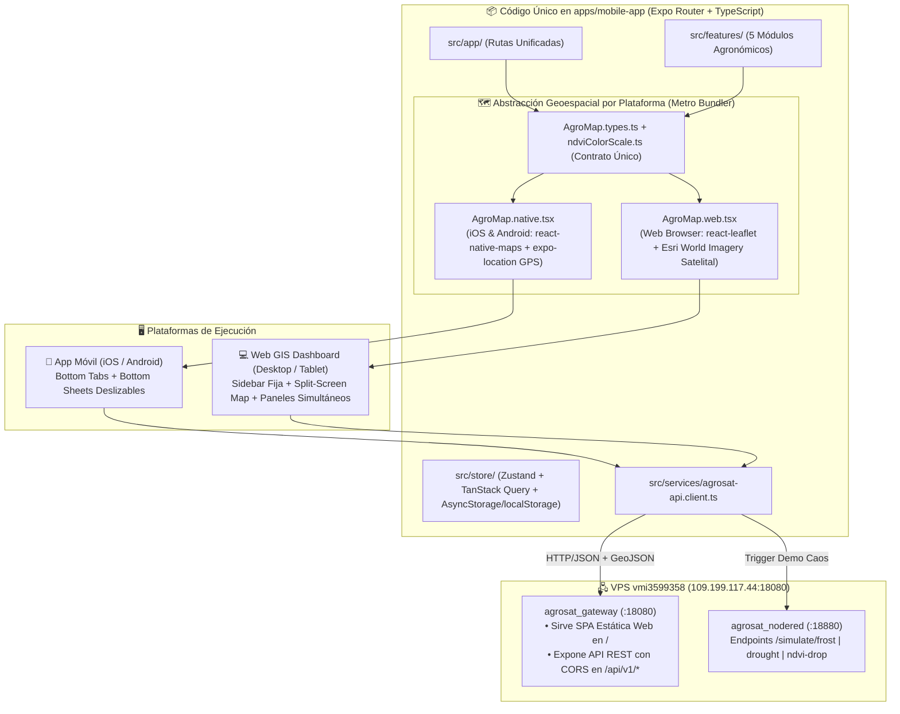

# 📱🌐 AgroSat AI — Especificación Técnica del Frontend Multiplataforma (`FRONTEND_SPEC.md`)
**Código Único para iOS, Android y Navegador Web con React Native + Expo (Expo Router + React Native Web)**

---

## 1. Visión Arquitectónica: Aplicación Universal (Móvil + Web GIS Dashboard)

El frontend de **AgroSat AI** (`apps/mobile-app`) está diseñado bajo el paradigma de **Aplicación Universal Multiplataforma** utilizando **Expo SDK 51+ (TypeScript), Expo Router v3 y React Native Web**.

Con una única base de código:
1. **En Campo (iOS y Android Nativo)**: El agricultor utiliza su teléfono con GPS integrado para caminar o trazar los linderos de su parcela de sandía, revisar el mapa de calor NDVI con una sola mano y consultar al Agrónomo Virtual.
2. **En Escritorio / Tablet (Navegador Web en `http://109.199.117.44:18080`)**: Se transforma automáticamente en una **Estación de Monitoreo y Demostración GIS a pantalla completa**, con barra lateral fija, mapa satelital interactivo, gráficas de telemetría en vivo, chat lateral con DeepSeek y el **Panel de Simulación Demo** para inyectar anomalías en tiempo real durante presentaciones técnicas.



---

## 2. Estructura Modular del Proyecto (`apps/mobile-app`)

```text
apps/mobile-app/
├── src/
│   ├── app/                                      # Expo Router (File-based routing universal)
│   │   ├── _layout.tsx                           # Layout Adaptativo: Sidebar (Web >= 768px) vs Bottom Tabs (Móvil < 768px)
│   │   ├── index.tsx                             # Redirección a /(dashboard)/parcels
│   │   └── (dashboard)/
│   │       ├── parcels.tsx                       # Módulo 1: Mis Parcelas y Zonificación Edafológica (MS2)
│   │       ├── satellite.tsx                     # Módulo 2: Monitoreo Satelital NDVI/EVI (MS1)
│   │       ├── telemetry.tsx                     # Módulo 3: Telemetría Climática y Alertas + QR Telegram (MS3 & MS5)
│   │       ├── agronomist.tsx                    # Módulo 4: Chat con el "Agrónomo Virtual" DeepSeek RAG (MS4)
│   │       └── simulator.tsx                     # Módulo 5: Panel Interactivo de Simulación Demo (Caos en Vivo)
│   │
│   ├── components/
│   │   ├── map/                                  # Motor Geoespacial Multiplataforma
│   │   │   ├── AgroMap.types.ts                  # Interfaz estricta compartida (AgroMapProps)
│   │   │   ├── AgroMap.native.tsx                # Implementación iOS/Android con react-native-maps
│   │   │   ├── AgroMap.web.tsx                   # Implementación Web con Leaflet + Esri World Imagery
│   │   │   ├── ndvi-color-scale.util.ts          # Escala cromática continua NDVI [-0.1 a 0.85] -> HEX/RGBA
│   │   │   └── MapLegendOverlay.tsx              # Leyenda flotante de vigor NDVI y clases de suelo FAO
│   │   ├── layout/
│   │   │   ├── AdaptiveShell.tsx                 # Contenedor responsivo Desktop Split-View vs Mobile Sheet
│   │   │   ├── WebSidebar.tsx                    # Navegación lateral para navegador Web
│   │   │   └── MobileBottomSheet.tsx             # Panel deslizable para uso con una mano en campo
│   │   └── charts/
│   │       └── UniversalTelemetryChart.tsx       # Gráficas basadas en react-native-svg (100% compatibles Web + Móvil)
│   │
│   ├── features/
│   │   ├── zoning/                               # Componentes y hooks del Módulo 1 (MS2)
│   │   │   ├── SoilSuitabilityCard.tsx           # Score 0-100%, velocímetro visual, pH, textura y drenaje
│   │   │   └── ParcelDrawingToolbar.tsx          # Controles: "Añadir Vértice", "Usar mi GPS", "Cerrar Polígono"
│   │   ├── satellite/                            # Componentes y hooks del Módulo 2 (MS1)
│   │   │   ├── PassTimelineSelector.tsx          # Carrusel de fechas y etapas fenológicas (0-90 DAS)
│   │   │   └── StressPatchAlertBanner.tsx        # Alerta visual cuando se detecta mancha de NDVI < 0.30
│   │   ├── telemetry-alerts/                     # Componentes y hooks del Módulo 3 (MS3 & MS5)
│   │   │   ├── SoilMoistureDualGauge.tsx         # Indicadores de humedad a 20cm (raíz activa) y 40cm (reserva)
│   │   │   ├── AlertsFeedList.tsx                # Historial de alertas críticas disparadas
│   │   │   └── TelegramLinkModal.tsx             # Botón Deep Link (móvil) + Código QR escaneable (Web)
│   │   ├── virtual-agronomist/                   # Componentes y hooks del Módulo 4 (MS4)
│   │   │   ├── AgronomistChatView.tsx            # Historial de conversación Markdown con citas de pgvector
│   │   │   └── QuickPromptChips.tsx              # Chips de consulta rápida para sandía
│   │   └── demo-simulator/                       # Componentes y hooks del Módulo 5 (Simulación en Vivo)
│   │       └── ChaosControlDeck.tsx              # Botones para disparar Helada, Sequía y Caída de NDVI
│   │
│   ├── services/
│   │   ├── api-client.ts                         # Instancia Axios/Fetch hacia http://109.199.117.44:18080/api/v1
│   │   ├── zoning.service.ts
│   │   ├── satellite.service.ts
│   │   ├── telemetry.service.ts
│   │   ├── agronomist.service.ts
│   │   └── chaos-simulator.service.ts
│   │
│   └── store/
│       ├── useActiveParcelStore.ts               # Estado global (Zustand + persistencia multiplataforma)
│       └── query-client.ts                       # Configuración de TanStack Query v5
│
├── app.json                                      # Configuración Expo (iOS, Android y Web bundler: metro)
├── package.json
└── tsconfig.json
```

---

## 3. Diseño Responsivo Adaptativo, Persistencia y Despliegue Web en el VPS

### 3.1 Layout Adaptativo (`src/app/_layout.tsx` y `AdaptiveShell.tsx`)

El componente raíz evalúa en tiempo real `Platform.OS` y `useWindowDimensions().width`:

| Característica UI | Modo Móvil (`iOS / Android` o `width < 768px`) | Modo Web GIS Dashboard (`Web` con `width >= 768px`) |
| :--- | :--- | :--- |
| **Navegación Principal** | **Bottom Tabs** de 5 iconos grandes en la parte inferior de la pantalla (fácil alcance con el pulgar en campo). | **Sidebar Izquierda Fija (`260px`)** con selector rápido de parcela activa, estado de conexión al VPS y enlaces a los 5 módulos. |
| **Distribución Espacial** | **Mapa a pantalla completa (`100%`)** en el fondo + **Bottom Sheet deslizable** (3 niveles: colapsado `15%`, medio `45%`, expandido `85%`) para ver tarjetas de suelo, NDVI o chat. | **Vista Multi-Panel (Split-Screen)**: Mapa interactivo ocupando el `60%` central/izquierdo y panel derecho fijo (`40%`) mostrando simultáneamente las tarjetas de aptitud, gráficas de telemetría, el Chat IA y el **Panel de Simulación Demo**. |
| **Trazado de Parcelas** | Toque en pantalla o botón **"📍 Capturar Vértice con mi GPS"** mientras el agricultor camina por las esquinas del terreno. | Clic con el cursor del mouse sobre las esquinas de la parcela visible en la capa satelital de Esri World Imagery. |

---

### 3.2 Cliente HTTP, CORS en `agrosat_gateway` y Almacenamiento Universal

1. **Configuración de CORS en `agrosat_gateway` (`apps/api-gateway/src/main.ts`)**:
   Para que el cliente Web (tanto en desarrollo local `localhost:8081` como servido desde el VPS `http://109.199.117.44:18080`) consuma la API sin bloqueos de navegador:
   ```typescript
   app.enableCors({
     origin: [
       'http://109.199.117.44:18080',
       'http://localhost:8081',
       'http://localhost:19006',
       '*', // Permitido para clientes móviles Expo Go / APK
     ],
     methods: ['GET', 'POST', 'PUT', 'PATCH', 'DELETE', 'OPTIONS'],
     allowedHeaders: ['Content-Type', 'Authorization', 'X-Farmer-Id'],
   });
   ```

2. **Persistencia Multiplataforma Transparente (`useActiveParcelStore.ts`)**:
   Utiliza `zustand/middleware` con `@react-native-async-storage/async-storage` (que en iOS/Android escribe en SQLite/Keychain nativo y en React Native Web utiliza automáticamente `window.localStorage`), conservando la parcela seleccionada, el `farmerId` y el `telegramChatId` entre recargas.

---

### 3.3 Estrategia de Compilación y Despliegue Web en el VPS (`:18080`)

Para presentar y operar **AgroSat AI** desde cualquier navegador de escritorio o teléfono sin necesidad de instalar primero el APK, la versión Web se compila como una **Single Page Application (SPA) estática** y es servida directamente por `agrosat_gateway` en el puerto **`18080`**:

1. **Compilación Estática con Metro Web Bundler**:
   ```bash
   cd apps/mobile-app
   EXPO_PUBLIC_API_URL=http://109.199.117.44:18080/api/v1 npx expo export --platform web
   # Genera el directorio optimizado apps/mobile-app/dist/ (HTML, JS bundles, fuentes e iconos)
   ```
2. **Servicio Estático Integrado en `agrosat_gateway` (`@nestjs/serve-static`)**:
   En `apps/api-gateway/src/gateway.module.ts`, se monta el bundle exportado en la raíz `/`, excluyendo el prefijo `/api/v1/*`:
   ```typescript
   ServeStaticModule.forRoot({
     rootPath: join(__dirname, '..', 'public-web'), // Copia de apps/mobile-app/dist
     exclude: ['/api/(.*)', '/docs/(.*)'],
   })
   ```
   **Resultado en el VPS**:
   - Abrir `http://109.199.117.44:18080` en Chrome/Firefox/Safari carga inmediatamente el **Dashboard Web GIS de AgroSat AI**.
   - Abrir `http://109.199.117.44:18080/api/v1/...` responde a las peticiones REST tanto de la Web como de la App Móvil en iOS/Android.
   - Abrir `http://109.199.117.44:18080/docs` muestra la documentación interactiva Swagger de los 5 microservicios.

---

## 4. Abstracción del Motor Geoespacial (`AgroMap.native.tsx` vs. `AgroMap.web.tsx`)

Dado que `react-native-maps` depende de vistas nativas de Google Maps / Apple Maps que no existen en el DOM del navegador, diseñamos un componente polimórfico `<AgroMap />` resuelto automáticamente por Metro Bundler según la extensión del archivo (`.native.tsx` vs `.web.tsx`).

### 4.1 Contrato Único de Propiedades (`src/components/map/AgroMap.types.ts`)

Ambas implementaciones consumen exactamente la misma interfaz TypeScript:

```typescript
// src/components/map/AgroMap.types.ts
export interface LatLngCoord {
  latitude: number;
  longitude: number;
}

export interface SpectralSubcellFeature {
  id: string;
  coordinates: LatLngCoord[]; // Anillo del sub-polígono (~10m x 10m) de PostGIS
  ndvi: number;               // [-0.10 a 0.85]
  evi: number;
  isStressedCell: boolean;
}

export interface ParcelBoundaryFeature {
  parcelId: string;
  name: string;
  coordinates: LatLngCoord[];
  centroid: LatLngCoord;
  viabilityScorePct?: number;
}

export interface AgroMapProps {
  initialCenter: LatLngCoord;
  initialZoom?: number;
  isDrawingMode: boolean;
  draftVertices: LatLngCoord[];
  parcels: ParcelBoundaryFeature[];
  selectedParcelId?: string | null;
  ndviGridCells: SpectralSubcellFeature[];
  showNdviOverlay: boolean;
  ndviOverlayOpacity?: number; // Default: 0.72
  onMapPressAddVertex?: (coord: LatLngCoord) => void;
  onSelectParcel?: (parcelId: string) => void;
  onSelectSubcell?: (cell: SpectralSubcellFeature) => void;
}
```

### 4.2 Escala Cromática Agronómica Compartida (`ndvi-color-scale.util.ts`)

Tanto `AgroMap.native.tsx` como `AgroMap.web.tsx` colorean cada sub-celda de PostGIS invocando la misma función pura:

```typescript
// src/components/map/ndvi-color-scale.util.ts
export function getNdviColorHex(ndvi: number): string {
  if (ndvi < 0.20) return '#D32F2F'; // Rojo Crítico: Suelo desnudo / Marchitez severa / Fallo de riego
  if (ndvi < 0.35) return '#F57C00'; // Naranja Alerta: Estrés hídrico o foco inicial de plaga (0.20 - 0.34)
  if (ndvi < 0.50) return '#FBC02D'; // Amarillo Moderado: Crecimiento inicial de guías (0.35 - 0.49)
  if (ndvi < 0.65) return '#7CB342'; // Verde Claro: Dosel en expansión saludable (0.50 - 0.64)
  return '#1B5E20';                  // Verde Intenso (> 0.65): Vigor fotosintético óptimo en floración/cuajado
}
```

---

### 4.3 Implementación Móvil: `AgroMap.native.tsx` (iOS y Android)

- **Motor**: `react-native-maps` (`MapView` con `mapType="hybrid"` para mostrar imagen satelital real con nombres de caminos).
- **Integración GPS de Campo**: Incluye un botón flotante que usa `expo-location` (`Location.getCurrentPositionAsync({ accuracy: Location.Accuracy.Highest })`) permitiendo al agricultor agregar el vértice exacto donde está parado o tocar puntos sobre el mapa (`onPress`).
- **Renderizado de la Malla de Calor PostGIS**:
  Itera sobre `ndviGridCells` renderizando componentes `<Polygon />` nativos con `fillColor={hexToRgba(getNdviColorHex(cell.ndvi), ndviOverlayOpacity)}` y borde resaltado en rojo parpadeante si `cell.isStressedCell === true`.

---

### 4.4 Implementación Web: `AgroMap.web.tsx` (Navegador Desktop / Tablet)

- **Motor**: `react-leaflet` + `leaflet` (100% gratuito, sin requerir tokens de Google Cloud ni Mapbox).
- **Capa Satelital de Alta Resolución (Esri World Imagery)**:
  ```tsx
  <TileLayer
    attribution="Tiles &copy; Esri &mdash; Source: Esri, Maxar, Earthstar Geographics"
    url="https://server.arcgisonline.com/ArcGIS/rest/services/World_Imagery/MapServer/tile/{z}/{y}/{x}"
    maxZoom={19}
  />
  ```
- **Trazado con Mouse y Renderizado GeoJSON**:
  Utiliza `useMapEvents({ click(e) { if (isDrawingMode) onMapPressAddVertex({ latitude: e.latlng.lat, longitude: e.latlng.lng }); } })` y renderiza cada sub-celda de `ndviGridCells` mediante `<Polygon positions={...} pathOptions={{ fillColor: getNdviColorHex(cell.ndvi), fillOpacity: ndviOverlayOpacity, weight: 0.5 }} />` con un `<Tooltip>` que muestra al pasar el mouse: `NDVI: 0.28 | EVI: 0.21 (Foco de Estrés)`.

---

## 5. Especificación de las Pantallas y los 5 Módulos Funcionales

### 5.1 Módulo 1: Mis Parcelas y Zonificación Edafológica (`MS2` — `/(dashboard)/parcels.tsx`)

1. **Flujo de Delimitación de Polígono**:
   - El usuario activa **"➕ Nueva Parcela de Sandía"**, ingresa el nombre (ej. *"Lote Sandía Norte"*) y la variedad (*Crimson Sweet*, *Charleston Gray*, *Sangría*) y marca los vértices en `<AgroMap />`.
   - Al pulsar **"Evaluar Aptitud en PostGIS"**, envía el polígono GeoJSON a `POST /api/v1/zoning/parcels`.
2. **Tarjeta de "Aptitud de Suelo para Sandía" (`SoilSuitabilityCard.tsx`)**:
   - Muestra el área geodésica exacta calculada por PostGIS (`ST_Area`, ej. `4.82 ha`).
   - Presenta un **anillo/velocímetro de viabilidad (`0% - 100%`)** con su clasificación (`ALTAMENTE APTO - 91%`).
   - Desglosa en barras de progreso los 5 parámetros simulados por `MS2`:
     - **Textura**: `Franco-Arenosa` (Ideal para raíces de sandía).
     - **pH del Suelo**: `6.4` (Rango óptimo `6.0 - 6.8`).
     - **Drenaje**: `Óptimo / Bueno` (Bajo riesgo de *Phytophthora*).
     - **Altitud y Pendiente**: `420 m.s.n.m.` | Pendiente `1.8%`.
     - **Radiación Solar**: `24.8 MJ/m²/día` (Excelente para acumulación de grados Brix).

---

### 5.2 Módulo 2: Monitoreo Satelital NDVI/EVI (`MS1` — `/(dashboard)/satellite.tsx`)

1. **Selector Cronológico de Pasadas Satelitales (`PassTimelineSelector.tsx`)**:
   - Barra horizontal deslizable con las fechas de las escenas simuladas Sentinel-2 y su **Etapa Fenológica** (`Día 12: Emergencia` $\rightarrow$ `Día 32: Guías` $\rightarrow$ `Día 52: Floración/Cuajado`).
2. **Superposición de Malla de Calor y Control de Opacidad**:
   - Switch para alternar entre `Vista NDVI`, `Vista EVI` y `Vista Satelital Limpia`, más un slider de opacidad (`0% - 100%`).
3. **Detector Visual de Zonas con Estrés Hídrico o Plaga (`StressPatchAlertBanner.tsx`)**:
   - Cuando la escena activa contiene celdas en rojo/naranja (`NDVI < 0.35`), muestra un banner interactivo: *"⚠️ Mancha de estrés detectada en el sector Noreste (NDVI mín: 0.28 | 19.4% del área afectada)"*. Al tocar el banner, la cámara de `<AgroMap />` hace zoom directo sobre las coordenadas del foco y ofrece el botón **"🔍 Diagnosticar este foco con el Agrónomo Virtual"**.

---

### 5.3 Módulo 3: Telemetría Climática y Centro de Alertas (`MS3` y `MS5` — `/(dashboard)/telemetry.tsx`)

1. **Tarjetas de Tiempo Real y Sensores de Doble Profundidad (`20cm` y `40cm`)**:
   - Consumo reactivo (`refetchInterval: 10000` con TanStack Query) de `GET /api/v1/telemetry/parcels/:id/history`.
   - Muestra indicadores diferenciados para **Humedad a 20 cm** (raíz absorbente activa; alerta roja si $< 25\%$) y **Humedad a 40 cm** (reserva profunda), junto con **Temperatura Ambiente**, **Radiación Solar ($W/m^2$)** y **VPD ($kPa$)**.
2. **Gráficas Multiplataforma (`UniversalTelemetryChart.tsx`)**:
   - Construidas sobre `react-native-svg` para renderizar de forma idéntica en iOS, Android y Web.
   - Permite conmutar entre la ventana de **Últimas 24 Horas** y **Últimos 7 Días**, dibujando líneas de umbral crítico (línea roja superior en $38^\circ\text{C}$ por golpe de calor y línea azul inferior en $4^\circ\text{C}$ por helada).
3. **Historial de Alertas y Vinculación con Bot de Telegram (`TelegramLinkModal.tsx`)**:
   - Lista cronológica de alertas disparadas por `MS5` con su estado de entrega (`SENT_TO_N8N` / `DELIVERED_TELEGRAM`).
   - Formulario para registrar el `telegram_chat_id` del agricultor (`POST /api/v1/alerts/farmers`) acompañado de:
     - **En Móvil**: Botón de apertura directa `Linking.openURL('https://t.me/AgroSatWatermelonBot')`.
     - **En Web**: Código QR generado en pantalla para escanear con el teléfono y abrir el Bot de Telegram al instante.

---

### 5.4 Módulo 4: Chat con el "Agrónomo Virtual" (`MS4` — `/(dashboard)/agronomist.tsx`)

1. **Cabecera de Contexto Activo**:
   - Muestra al agricultor qué datos reales de su parcela se están enviando automáticamente a **DeepSeek + `pgvector`** en cada pregunta: `[Parcela: Lote Norte (4.8 ha) | NDVI: 0.64 | pH: 6.4 | Temp: 31.2°C | Humedad 20cm: 29%]`.
2. **Chips de Consulta Rápida Especializados en Sandía (`QuickPromptChips.tsx`)**:
   - `💧 "¿Cuánto debo regar hoy según la humedad a 20cm y 40cm?"`
   - `🛰️ "Analizar la caída de NDVI en el sector noreste"`
   - `🕷️ "Prevención de araña roja y Fusarium en esta etapa"`
   - `🍉 "Plan de Calcio y Boro para evitar necrosis apical"`
3. **Renderizado Estructurado de la Respuesta de DeepSeek**:
   - Muestra los 4 bloques generados por `MS4` (*Diagnóstico*, *Acción de Riego*, *Nutrición/Fitosanidad* y *Qué Vigilar en 48h*) más un acordeón desplegable **"📚 Fuentes Técnicas Consultadas en `pgvector`"** que exhibe los fragmentos del manual de sandía recuperados por `Xenova/multilingual-e5-small` y su porcentaje de similitud coseno.

---

### 5.5 Módulo 5: "Panel de Simulación Demo" (`/(dashboard)/simulator.tsx` o Drawer Flotante)

Para facilitar las pruebas integrales y demostraciones en vivo desde el navegador Web o el teléfono, este módulo expone un **Tablero de Control de Caos (Chaos Control Deck)** con 4 acciones de un solo clic:

| Botón de Acción en UI | Endpoint Disparado | Efecto Visual Inmediato en el Sistema (Tiempo Real) |
| :--- | :--- | :--- |
| **❄️ 1. Simular Helada Nocturna ($1.5^\circ\text{C}$)** | `POST :18880/simulate/frost` | 1. La gráfica de temperatura en el Módulo 3 cae en picada a **$1.5^\circ\text{C}$**.<br/>2. Aparece una alerta `CRITICAL` en el Centro de Alertas.<br/>3. En $< 3\text{ s}$ llega la notificación push real al **Bot de Telegram** con la recomendación de emergencia de DeepSeek. |
| **🔥 2. Simular Golpe de Calor + Sequía ($39^\circ\text{C}$ / $18\%$ HR)** | `POST :18880/simulate/drought` | 1. El medidor de humedad a 20cm se pone en rojo (**$18\%$**) y la temperatura sube a **$39^\circ\text{C}$**.<br/>2. `MS5` detecta riesgo de aborto floral y *Blossom-End Rot* y despacha la alerta por `n8n` $\rightarrow$ **Telegram**. |
| **🛰️ 3. Simular Plaga / Caída de NDVI a `0.28`** | `POST :18880/simulate/ndvi-drop` | 1. `MS1` recalcula la grilla en PostGIS inyectando una mancha gaussiana de estrés.<br/>2. En `<AgroMap />` aparece en vivo el parche de celdas rojas/naranjas (`NDVI = 0.28`) sobre el sector noreste de la parcela.<br/>3. Llega alerta satelital a **Telegram** con las coordenadas GPS del foco. |
| **🌿 4. Restaurar Estado Saludable Nominal** | `POST /api/v1/satellite/...` + lectura nominal `MS3` | Restablece la temperatura a $27.5^\circ\text{C}$, la humedad a 20cm a $31\%$ y el dosel satelital a un NDVI saludable de `0.72` (verde intenso uniforme). |
