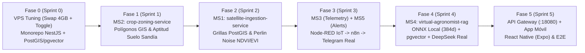

# 🗺️ AgroSat AI — Hoja de Ruta y Plan de Desarrollo Incremental (`ROADMAP.md`)
**Monitoreo Satelital Sintético, Zonificación GIS, Telemetría IoT y Agrónomo Virtual para el Cultivo de Sandía**

---

## 1. Visión General del Ciclo de Desarrollo

El desarrollo de **AgroSat AI** se estructura en **6 Fases (Sprints incrementales)**. Cada Sprint entrega una tajada vertical completamente funcional y verificable en el VPS `vmi3599358`, comenzando por los cimientos geoespaciales/vectoriales (`PostGIS` + `pgvector`), construyendo los generadores sintéticos y culminando con las integraciones reales (`ONNX Local Embeddings`, `DeepSeek API`, `n8n` + `Telegram Bot API`) y la aplicación móvil multiplataforma.

---

## Fase 0 (Sprint 0): Preparación del VPS `vmi3599358` vía Prompts, Cimientos del Monorepo y Base de Datos Híbrida

### Objetivo
Acondicionar el VPS Ubuntu 24.04 (`vmi3599358`) mediante los **Prompts Operativos del Agente del VPS** (activación del archivo Swap de 4 GB y conmutación a "Modo Dedicado AgroSat AI"), inicializar el Monorepo en NestJS + TypeScript con las librerías base de DDD (`shared-kernel`), y levantar el contenedor unificado `agrosat_postgres` con **`PostGIS 3.4` y `pgvector 0.7`** operativos.

### Entregables Técnicos
1. **Ejecución de Prompts Operativos en el VPS (documentados en `DOCKER_PLAN.md` §4)**:
   - **Prompt 1 (Configurar Swap 4 GB)**: Creación idempotente de `/swapfile` de 4 GB con `vm.swappiness=10` y `vm.vfs_cache_pressure=50`.
   - **Prompt 2 (Activar Modo Dedicado AgroSat AI)**: Pausado limpio de `rempolived_app`, `ffmpeg` y `webplayer_*` para liberar los 6 vCPUs AMD EPYC, manteniendo activos `monitoring_dozzle (:9846)` y `monitoring_dashdot (:9845)`.
   - **Prompt 3 (Restaurar Modo Habitual)**: Prompt de retorno para detener `agrosat_*` y reanudar tus servicios habituales al finalizar cada sesión.
2. **Estructura Base del Monorepo NestJS**:
   - Configuración de `nest-cli.json`, `tsconfig.base.json` y `package.json`.
   - `libs/shared-kernel`: Clases abstractas `Entity<T>`, `AggregateRoot<T>`, `ValueObject<T>`, `Result<T, E>` y `DomainException`.
   - `libs/gis-contracts`: Tipos e interfaces GeoJSON (`GeoJsonPolygon`, `GeoJsonFeatureCollection`) y validador de coordenadas `SRID 4326`.
   - `libs/service-contracts`: Contratos tipados para canales `LISTEN/NOTIFY` de PostgreSQL.
3. **Base de Datos Unificada (`infra/docker/postgres/`)**:
   - `Dockerfile.postgis-pgvector` y script `01-init-db.sql` creando las extensiones `postgis` y `vector`, junto con los 5 esquemas aislados (`ms1_satellite`, `ms2_zoning`, `ms3_telemetry`, `ms4_rag`, `ms5_alerts`).

### Criterios de Aceptación y Verificación
- [ ] Al enviar el **Prompt 1** y el **Prompt 2** al agente del VPS, el `Load Average` baja de `< 1.0`, `swapon --show` confirma 4 GB de Swap activos y quedan `> 8.5 GB` de RAM disponible.
- [ ] `docker exec agrosat_postgres psql -U agrosat_admin -d agrosat_db -c "SELECT PostGIS_Full_Version(), extversion FROM pg_extension WHERE extname = 'vector';"` devuelve versión activa de PostGIS 3.4 y `pgvector`.

---

## Fase 1 (Sprint 1): Delimitación Geoespacial y Aptitud Edafológica para Sandía (`MS2: crop-zoning-service`)

### Objetivo
Permitir el registro de polígonos geoespaciales de parcelas agrícolas, validar su topología real en **PostGIS**, calcular su superficie en hectáreas y simular la zonificación edafológica evaluando la aptitud del suelo para el cultivo de sandía (*Citrullus lanatus*).

### Entregables Técnicos (`apps/ms2-crop-zoning-service`)
1. **Capa de Dominio (`src/domain/`)**:
   - Entidades: `ParcelPolygon` (Aggregate Root) y `SoilSuitabilityZone`.
   - Objetos de Valor con invariantes agronómicas para sandía:
     - `SoilPh` (óptimo `5.8 - 6.6`), `SoilTexture` (`SANDY_LOAM` preferido), `DrainageClass` (`WELL_DRAINED`), `SlopePercentage` (`< 5%`) y `ElectricalConductivity` (`< 2.0 dS/m`).
     - `WatermelonSuitabilityScore`: Calcula el puntaje ponderado (`0-100`) y asigna categoría FAO (`S1: Altamente Apto`, `S2: Moderadamente Apto`, `S3: Marginalmente Apto`, `N: No Apto`).
2. **Capa de Aplicación (`src/application/`)**:
   - Casos de uso: `RegisterParcelPolygonUseCase`, `EvaluateWatermelonSuitabilityUseCase`, `GetParcelZoningGeoJsonUseCase`.
   - Puertos de salida: `ParcelSpatialRepositoryPort` y `EdaphologicalSimulatorPort`.
3. **Capa de Infraestructura (`src/infrastructure/`)**:
   - `PostgisParcelZoningRepository`: Consultas espaciales reales con `ST_GeomFromGeoJSON`, `ST_SetSRID(..., 4326)`, `ST_IsValid`, `ST_Area(geom::geography) / 10000.0` y subdivisión en cuadrantes/sub-zonas con `ST_Subdivide` / `ST_Clip`.
   - `SyntheticEdaphologyAdapter`: Generador determinista por semilla que asigna propiedades físico-químicas de suelo realistas a cada sub-zona del polígono.

### Criterios de Aceptación y Verificación
- [ ] Al enviar un polígono GeoJSON de prueba (`POST /api/v1/parcels`), `MS2` rechaza polígonos auto-intersectados (`ST_IsValid = false`) con una excepción de dominio clara.
- [ ] Para un polígono válido, `MS2` calcula el área real en hectáreas en PostGIS, genera 4 sub-zonas edafológicas y retorna un `FeatureCollection` GeoJSON con el puntaje de aptitud para siembra de sandía y recomendaciones de enmienda (ej. encalado dolomítico si $\text{pH} < 5.5$).

---

## Fase 2 (Sprint 2): Teledetección Satelital Sintética e Índices NDVI/EVI (`MS1: satellite-ingestion-service`)

### Objetivo
Simular pasadas orbitales Sentinel-2 sobre las parcelas registradas en `MS2`, subdividiendo el polígono en una grilla espacial de celdas ($10\text{m} \times 10\text{m}$) en **PostGIS** y generando bandas espectrales realistas mediante **Ruido Perlin 2D** acoplado a la curva fenológica de 90 días de la sandía (aprovechando los 6 vCPUs sin bloqueos artificiales).

### Entregables Técnicos (`apps/ms1-satellite-ingestion-service`)
1. **Capa de Dominio (`src/domain/`)**:
   - Entidades: `SatellitePass` (Aggregate Root) y `SpectralGridCell`.
   - Objetos de Valor: `SpectralBands` ($B_{02}, B_{04}, B_{08}$), `NdviValue` ($\frac{B_{08}-B_{04}}{B_{08}+B_{04}}$), `EviValue`, `WatermelonPhenologicalStage` (`EMERGENCE`, `VINE_GROWTH`, `FLOWERING_FRUIT_SET`, `MATURATION`).
2. **Capa de Aplicación (`src/application/`)**:
   - Casos de uso: `SimulateSatellitePassUseCase`, `InjectLocalizedPestStressUseCase` (simula un foco circular de caída de NDVI por *Fusarium oxysporum* o rotura de cintilla de riego), `GetParcelHeatmapGeoJsonUseCase` y `GetNdviTimeSeriesUseCase`.
3. **Capa de Infraestructura (`src/infrastructure/`)**:
   - `PostgisSpectralGridRepository`: Genera la malla de celdas reales dentro del polígono usando `ST_SquareGrid` + `ST_Intersects` en PostGIS y persiste las geometrías con índice espacial `GIST`.
   - `PerlinNoiseSentinel2Adapter`: Implementación de Ruido Perlin 2D coherente + curva fenológica de sandía.
   - `PgNotifyAnomalyPublisher`: Si la pasada satelital detecta una caída $\Delta\text{NDVI} \le -0.15$ o más del $18\%$ de celdas en estrés severo, publica el evento en el canal `ndvi_anomaly_channel` hacia `MS5`.
   - Herramienta CLI `tools/simulators/perlin-ndvi-cli`: Script para poblar el historial de pasadas satelitales (cada 5 días desde el Día 1 al Día 75 del cultivo).

### Criterios de Aceptación y Verificación
- [ ] Ejecutar la simulación de una parcela de 5 hectáreas (~500 celdas en PostGIS) se completa en `< 400 ms` utilizando el paralelismo de los 6 vCPUs.
- [ ] El endpoint `GET /api/v1/satellite/parcels/:id/heatmap` devuelve un `FeatureCollection` GeoJSON donde los valores de NDVI exhiben continuidad espacial suave (gracias al Ruido Perlin 2D) y reflejan la etapa fenológica actual de la sandía.

---

## Fase 3 (Sprint 3): Telemetría IoT con Node-RED y Motor de Alertas Reales con n8n + Telegram (`MS3` + `MS5`)

### Objetivo
Poner en marcha el motor de simulación de campo en **Node-RED (`:18880`)** enviando lecturas periódicas y eventos críticos hacia **`MS3 (agronomic-telemetry-service)`**, evaluar anomalías en tiempo real en **`MS5 (alert-notification-service)`** y disparar **Webhooks reales hacia `n8n (:15678)`** para notificar al agricultor en su teléfono vía **Telegram Bot API**.

### Entregables Técnicos (`apps/ms3-*`, `apps/ms5-*`, `tools/simulators/node-red`, `tools/simulators/n8n`)
1. **MS3 — `agronomic-telemetry-service`**:
   - Dominio con cálculo automático de **Déficit de Presión de Vapor (`VPD` en kPa)** mediante la ecuación de Tetens.
   - Persistencia de series temporales en `ms3_telemetry.readings` y emisión de eventos por `PG NOTIFY` (`telemetry_anomaly_channel`) cuando los parámetros salen del rango fisiológico de la sandía.
2. **MS5 — `alert-notification-service`**:
   - Servicio de Dominio `WatermelonRuleEvaluator` con las 5 reglas críticas (`RULE_FROST_CRITICAL`, `RULE_CHILLING_INJURY`, `RULE_FLOWER_ABORT_HEAT`, `RULE_WATER_DEFICIT_FRUIT`, `RULE_SUDDEN_NDVI_DROP`).
   - Control de ventana de enfriamiento (*cooldown* configurable por parcela y tipo de regla) para evitar inundar Telegram.
   - Adaptador `N8nAlertWebhookAdapter` que realiza `POST` HTTP real hacia `http://agrosat_n8n:5678/webhook/agrosat-watermelon-alert`.
3. **Flujos Preconfigurados de Node-RED y n8n**:
   - `tools/simulators/node-red/flows.json`: Incluye un generador automático con ciclo diurno/nocturno sinusoidal cada 5 minutos + **4 botones de inyección manual de caos**:
     1. *Inyectar Helada Nocturna ($1.2^\circ\text{C}$)*
     2. *Inyectar Golpe de Calor en Floración ($40.5^\circ\text{C}$, $\text{HR } 18\%$)*
     3. *Inyectar Sequía Aguda en Cuajado ($\text{Humedad Suelo } 14\%$)*
     4. *Restaurar Condiciones Nominales ($27^\circ\text{C}$, $\text{Humedad Suelo } 32\%$)*
   - `tools/simulators/n8n/telegram-watermelon-alerts.json`: Workflow listo para importar en `agrosat_n8n` conectado a `Telegram Bot API`.

### Criterios de Aceptación y Verificación
- [ ] Al presionar el botón *"Inyectar Helada Nocturna"* en Node-RED (`http://109.199.117.44:18880`), `MS3` registra la lectura, notifica a `MS5`, `MS5` dispara el webhook a `n8n` y el mensaje de alerta llega en **menos de 3 segundos al chat real de Telegram** del agricultor con las coordenadas de la parcela y la acción correctiva.
- [ ] Al simular un foco de estrés en `MS1` (`InjectLocalizedPestStressUseCase`), `MS5` recibe el evento `ndvi_anomaly_channel` y envía una alerta real por Telegram indicando el porcentaje de área afectada y el centroide GPS del foco.

---

## Fase 4 (Sprint 4): Agrónomo Virtual RAG con Embeddings Locales ONNX, `pgvector` y API Real de DeepSeek (`MS4`)

### Objetivo
Implementar **`MS4 (virtual-agronomist-rag-service)`** respetando estrictamente la separación entre el puerto de embeddings (**100% local en Node.js con `@huggingface/transformers` y `Xenova/multilingual-e5-small`**) y el puerto de generación de texto (**API Real de DeepSeek**), indexando el corpus técnico de cultivo de sandía en `pgvector`.

### Entregables Técnicos (`apps/ms4-virtual-agronomist-rag-service` y `tools/simulators/seed-watermelon-kb`)
1. **Corpus Agronómico Especializado en Sandía (`tools/simulators/seed-watermelon-kb/`)**:
   - Documentos técnicos estructurados sobre:
     - Requerimientos hídricos y coeficientes de cultivo ($K_c$) de la sandía por etapa fenológica.
     - Fertirrigación N-P-K, Calcio y Boro (prevención de *Blossom-End Rot* y corazón hueco).
     - Diagnóstico diferencial y control integrado de plagas y enfermedades (*Fusarium oxysporum f. sp. niveum*, *Pseudoperonospora cubensis*, *Tetranychus urticae* / arañita roja, mosca blanca).
     - Manejo de suelos ácidos/alcalinos y enmiendas edáficas.
   - Script de *seeding* que fragmenta los documentos (*chunking* con solapamiento), los vectoriza localmente con `Xenova/multilingual-e5-small` (`passage: ...`) y los inserta en `ms4_rag.knowledge_chunks` con índice `HNSW`.
2. **Adaptador de Embeddings 100% Local (`LocalOnnxEmbeddingAdapter`)**:
   - Implementa `EmbeddingGeneratorPort` usando `@huggingface/transformers` sobre `node:20-bookworm-slim` (`glibc`), persistiendo el modelo en el volumen `agrosat_hf_cache`.
3. **Adaptador de Razonamiento Real con DeepSeek (`DeepSeekOpenAiLlmAdapter`)**:
   - Implementa `LlmReasoningPort` usando el SDK `openai` configurado hacia `https://api.deepseek.com` (`deepseek-chat`).
4. **Agregador de Contexto Holístico (`InternalMicroservicesContextAdapter`)**:
   - Antes de invocar a DeepSeek, `MS4` consulta automáticamente:
     - `MS1`: NDVI medio actual, tendencia de los últimos 15 días y presencia de focos de anomalía.
     - `MS2`: pH, textura, drenaje y puntaje de aptitud de las sub-zonas de la parcela.
     - `MS3`: Temperatura media/mínima/máxima, humedad de suelo y VPD de los últimos 7 días.

### Criterios de Aceptación y Verificación
- [ ] El seeding de la base de conocimiento vectoriza e indexa todos los manuales de sandía en `pgvector` (`vector(384)`) usando únicamente los vCPUs del VPS (sin ninguna llamada de red a APIs externas de embeddings).
- [ ] Al consultar `POST /api/v1/agronomist/consult` con una pregunta del agricultor, `MS4` vectoriza la pregunta en `< 30 ms`, recupera los 4 fragmentos más relevantes por similitud coseno en `pgvector`, adjunta el estado real de la parcela (`MS1` + `MS2` + `MS3`) y devuelve una prescripción técnica generada en vivo por **DeepSeek API**.

---

## Fase 5 (Sprint 5): API Gateway, Aplicación Móvil Multiplataforma (React Native) y Pruebas End-to-End

### Objetivo
Exponer todos los servicios de forma segura a través de `agrosat_api_gateway (:18080)`, construir la aplicación móvil multiplataforma en **React Native (Expo)** y validar el flujo completo desde el teléfono hasta PostGIS, DeepSeek y Telegram.

### Entregables Técnicos (`apps/api-gateway` y `apps/mobile-app`)
1. **API Gateway (`apps/api-gateway` en puerto `:18080`)**:
   - Enrutamiento unificado (`/api/v1/parcels/*`, `/api/v1/satellite/*`, `/api/v1/telemetry/*`, `/api/v1/agronomist/*`, `/api/v1/alerts/*`).
   - Documentación OpenAPI / Swagger consolidada en `http://109.199.117.44:18080/docs`.
2. **Aplicación Móvil React Native (`apps/mobile-app`)**:
   - **Pantalla 1 — Mapa GIS y Zonificación**: Trazado de polígonos de parcelas, selector de capas (`Aptitud Edafológica S1-N` vs. `Mapa de Calor NDVI/EVI`).
   - **Pantalla 2 — Telemetría en Vivo**: Tarjetas y gráficas de Temperatura, Humedad de Suelo y VPD alimentadas por Node-RED.
   - **Pantalla 3 — Chat con el Agrónomo Virtual**: Consulta interactiva con visualización de las fuentes RAG y el diagnóstico de DeepSeek.
   - **Pantalla 4 — Centro de Alertas**: Historial de alertas críticas con estado de entrega en Telegram.

### Criterios de Aceptación y Verificación End-to-End
- [ ] Todos los 9 contenedores `agrosat_*` corren simultáneamente en el VPS `vmi3599358` consumiendo en conjunto menos de `5.25 GB` de RAM y siendo monitoreados en tiempo real desde `monitoring_dozzle (:9846)`.
- [ ] Prueba integral superada: Registrar parcela en la App Móvil $\rightarrow$ Generar zonificación de suelo en `MS2` $\rightarrow$ Simular pasada Sentinel-2 con foco de estrés en `MS1` $\rightarrow$ Inyectar sequía desde Node-RED en `MS3` $\rightarrow$ Recibir alerta real en Telegram vía `MS5` + `n8n` $\rightarrow$ Consultar al Agrónomo Virtual en `MS4` y recibir un plan de rescate de riego y manejo fitosanitario generado por DeepSeek.
